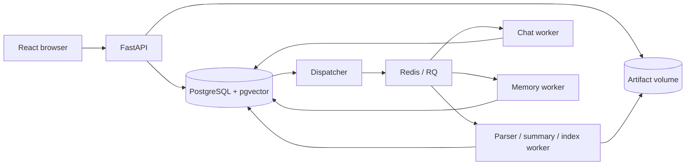

# Architecture

Folio turns one PDF into recoverable evidence, a cited summary and a saved conversation. A reader can open the
passage and original page behind an answer. Native text and English OCR are supported. Known extraction gaps
remain visible; valid citation IDs alone do not prove that a passage supports the answer. See
[evaluation](evaluation.md) for measured quality.

## Runtime

[Compose](../compose.yaml) serves the built web app through Nginx and exposes only localhost web/API ports.
PostgreSQL owns durable intent, evidence, chat state and accounting. Redis transports deliveries. The parser
worker consumes the shared ingestion queue; chat and memory have separate queues and lightweight images. The
dispatcher visits ingestion, summary, indexing, chat and memory work in one recovery loop. Model calls run in
workers. API and parser worker share original/result artifacts; chat and memory use persisted text.
PostgreSQL readiness checks TCP before migrations start. Its temporary initialization server accepts only
socket connections, so a socket-only health check could start migrations too early on an empty volume.

## Upload, evidence and indexing

A document, its immutable original, a processing request, an extraction revision and an index have different
identities. For example, D1 owns PDF F1; request J1 produces extraction R1, from which index I1 is built. This
preserves provenance without claiming a user-facing replacement or version-history feature.

Upload middleware freezes settings before multipart processing. Storage writes the original under an opaque key;
one transaction then creates the document, file, request, pending attempt and idempotency receipt. Repeating a
key with the same input returns the original IDs; changed input returns a conflict. File writes, PostgreSQL
commits and Redis enqueue are separate operations. An ambiguous database failure retains the original because
its commit may have succeeded. The dispatcher can recover committed intent after an API crash.

Docling maps recovered text, table relationships, physical pages and locations into Folio's own evidence model.
Usable partial extraction stays available with known warnings; an empty or unreadable result cannot supply
evidence. No-content detection cannot prove that nothing was missed. One guarded transaction publishes a
complete extraction revision.

Enabled summaries use all available evidence when it fits the configured input allowance. Oversized inputs
receive a summary-unavailable reason instead of silent truncation. A summary failure leaves extraction readable.
Summaries and indexes have their own state and attempts.

Indexing freezes exact contextualized chunk text, hashes, versions and ordered source links. Docling peer
merging preserves headings; OpenRouter embeddings have 1,536 dimensions stored in pgvector. Each delivery
processes one bounded batch. Successful batches survive retry, but only a complete index becomes ready and
exposes chunks. Source locations describe whole elements, not verified character spans. Unsupported mapping or
an oversized plan fails explicitly.

## Questions and conversation memory

A chat pins one ready document index. Question acceptance checks the ordered conversation head and saves an
idempotent turn. A follow-up keeps its original wording and a separately saved interpretation. Document
questions embed that resolved query and retrieve fresh whole chunks using exact cosine ranking inside the pinned
index. The default limit is six passages. The saved evidence is what the answer actually saw; S1 belongs to one
turn and cannot open another turn's source. References to original conversation messages are separate from PDF
citations.

A turn freezes its selected history and policy. Prior answers and older-history notes help interpret intent;
they do not prove document facts. Full original exchanges remain readable. Exact transcript quotations require
originals supplied in that turn's context; checking a reference's membership still cannot establish that its
quotation is exact.

After a terminal answer, a durable marker lets the planner prepare notes for an older complete prefix. Defaults
trigger this at 6,000 history tokens, target roughly 3,000, and keep at least two recent complete exchanges
unchanged. The target is soft; no message is cut to achieve it. A result must reduce actual context, including
metadata, before it can replace earlier notes.

Before claiming a question, Folio checks the hard 8,000-token history bound and full request limits. A fitting
context proceeds immediately. Otherwise the question waits on one durable memory dependency for at most 600
seconds, consuming no chat attempt or occupied worker. A current question or mandatory recent suffix that cannot
fit fails before paying for notes that cannot help. Failed, late or still-too-large preparation gives a saved
limitation, not an unbounded compression loop. Notes finishing during an answer cannot change its frozen input.

Soft deletion hides a chat and prevents new publication while retaining records and billing. Already admitted
calls may still incur costs. Memory can lose detail; its software checks and real conversation quality are
recorded separately in [evaluation](evaluation.md).

## Model calls and spending

Summaries use their separate DeepSeek route. Document/query embeddings stay on the index's OpenRouter/OpenAI
route. Answers, follow-up interpretation and memory each select OpenRouter or direct OpenAI independently. Saved
endpoint/profile versions control retries; legacy work without a gateway stays on OpenRouter. Credentials load
only at execution. There is no hidden client retry or cross-service fallback.
[Development](development.md#models-and-paid-work) lists supported combinations and safe switching instructions.

All stages use one persistent allowance. Admission locks the account briefly while checking
`spent amounts + unresolved holds + new hold` against deployment and document limits, then records the
reservation. The provider request runs outside that transaction. A second worker cannot spend the same remaining
allowance while the first admission is being recorded.

| Billing state | What counts against the allowance |
| --- | --- |
| `known` | Provider-reported dollar cost replaces its reservation. |
| `estimated` | Valid returned tokens priced with a versioned direct-OpenAI profile; an estimate, not an invoice amount. |
| `unknown` | No valid reported cost or trustworthy token estimate; the full reservation remains. Retrying needs new admission. |

A stale worker can settle a late charge but cannot publish an answer or memory. Cost/input overrun pauses new
paid admissions; running calls may still finish and settle. The accounting pause survives restarts. Reservations
are estimate-based controls and cannot guarantee a provider-enforced zero-overshoot limit. Unknown holds must
not be silently released.

## Recovery and capacity

A short transaction claims an authorized attempt with a token and lease. Another transaction checks that
ownership again before publishing success or failure. Expiry revokes publication permission; it does not prove
the old process stopped. If worker A finishes after recovery authorized worker B, A's token cannot overwrite B's
result. Repeated queue delivery is expected; the contract guards publication rather than promising exactly-once
execution.

Partial indexes find pending work and expired leases without scanning completed history. Unique constraints
enforce ordered evidence and one active question/memory job per chat. The `(revision_id, reading_order)` index
serves evidence pagination; an exact vector query is scoped to one index and currently has no approximate ANN
index. Measure actual queries with `EXPLAIN (ANALYZE, BUFFERS)` on representative data; `ANALYZE` executes the
statement, and a sequential scan can be appropriate for a small table.

One parser worker defaults to 4 CPUs/6 GiB; chat and memory each have 1 CPU/1 GiB. Additional workers share CPU,
memory, provider and database capacity. Each `Database` instance can use up to eight connections; this is not a
global ceiling. Worker scaling is configuration, not a throughput result. Named artifact volumes support the
current single-host arrangement. Multi-host operation needs shared storage and separate access, admission and
backup decisions.

Per-file limits do not bound total disk use or queue growth. Backpressure, document erasure, off-machine backups
and online artifact cleanup remain separate work. Reconcile abandoned files only with artifact writers stopped
and PostgreSQL recovered. `/health` checks API/database access; it does not certify worker availability, parser
accuracy or answer quality.

## Aggregate reads

`/statistics/documents` joins each document to its current request/original and
active evidence. It does not multiply file totals by pages or attempts.
`/metrics/processing` groups retained jobs and executions across all five stages,
including removed chats. A retry adds an attempt; a successful embedding batch
also adds an attempt. Neither creates another job.

Both routes use a read-only repeatable-read transaction: a worker finishing
between queries cannot make one response mix two database states. Ordinary
worker writes continue without waiting for row locks from these reads. Exact
all-history totals still scan records; indexes for finding pending work do not
make that scan constant-time. Measure latency and buffers as data grows before
adding cached totals or a reporting store.

## Source reading order

| Behavior | Start here, then follow the data |
| --- | --- |
| Upload and evidence | [API](../src/folio/api.py), [routes](../src/folio/ingestion/routes.py), [configuration capture](../src/folio/configuration/store.py), [acceptance](../src/folio/ingestion/acceptance.py), [storage](../src/folio/storage.py), then ingestion [dispatcher](../src/folio/ingestion/dispatcher.py), [ownership](../src/folio/ingestion/ownership.py), [processing](../src/folio/ingestion/processing.py), [parser](../src/folio/ingestion/parsing/parser.py), [publication](../src/folio/ingestion/publication.py) and [queries](../src/folio/ingestion/queries.py). |
| Summary and index | Summary [preparation](../src/folio/summaries/preparation.py), [processing](../src/folio/summaries/processing.py), [lifecycle](../src/folio/summaries/lifecycle.py); index [preparation](../src/folio/indexing/preparation.py), [chunking](../src/folio/indexing/chunking.py), [processing](../src/folio/indexing/processing.py), [lifecycle](../src/folio/indexing/lifecycle.py). |
| Question and follow-up | Conversation [routes](../src/folio/conversations/routes.py), [context](../src/folio/conversations/context.py), [resolver](../src/folio/conversations/resolver.py), [processing](../src/folio/conversations/processing.py), [retrieval](../src/folio/conversations/retrieval.py), [preparation](../src/folio/conversations/preparation.py), [queries](../src/folio/conversations/queries.py); ownership in [lifecycle](../src/folio/conversations/lifecycle.py), charges in [invocations](../src/folio/conversations/invocations.py). |
| Memory | [Context](../src/folio/conversations/memory/context.py), [planning](../src/folio/conversations/memory/planning.py), [processing](../src/folio/conversations/memory/processing.py), [lifecycle](../src/folio/conversations/memory/lifecycle.py), [dispatcher](../src/folio/conversations/memory/dispatcher.py). |
| Shared boundaries | [Generation routing](../src/folio/ai/routing.py), [provider-neutral results](../src/folio/ai/generation.py), [token admission](../src/folio/ai/tokens.py), [accounting](../src/folio/ai/budget.py), [transactions/migrations](../src/folio/database.py), [schema](../src/folio/migrations). |
| Aggregate APIs | Monitoring [routes](../src/folio/monitoring/routes.py), [response models](../src/folio/monitoring/models.py) and [queries](../src/folio/monitoring/queries.py); HTTP/database [checks](../tests/test_monitoring.py). |

Keep related behavior in its feature module. Preserve `folio.processing.process_attempt`, the compatibility
entrypoint used by persisted RQ messages. New schema changes get new migrations. As a reading exercise, trace
the expired-worker case in [recovery tests](../tests/test_recovery.py) through `owns` and `recover_expired`;
explain why a late charge can still settle through `conversations/invocations.py:settle` without publishing. Use
the [isolated checks](development.md#backend-checks).
