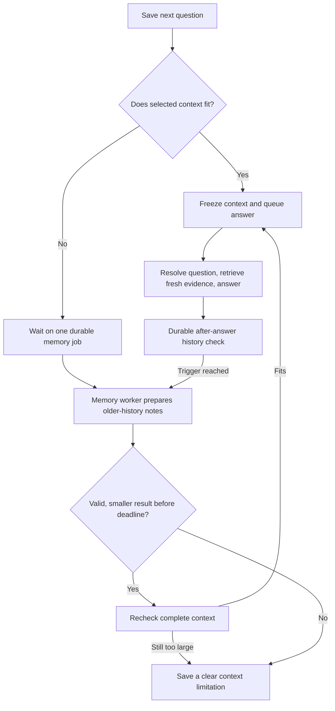

# Conversation memory

Folio keeps every original exchange. Memory is a shorter set of notes used to
interpret later questions, not a replacement transcript or evidence for PDF
claims. New questions still retrieve fresh passages from the pinned document.
The [conversation contract](conversations.md) records the accepted decisions;
[status](status.md) distinguishes software checks from live model-quality evidence.

## A concrete flow

Imagine a conversation reaches 6,000 tokens after answer 12. Folio records that
history needs checking in the same transaction that saves the answer. The
dispatcher can find that marker after a crash; it does not depend on an in-memory
callback surviving.

The planner captures an older, complete prefix, keeping at least the two latest
exchanges unchanged. A separate worker writes short notes about subjects,
constraints, corrections and unresolved questions. Its input, model settings,
covered-through sequence and predecessor memory are saved before generation.
The notes must reduce the actual context, including their identifiers and other
metadata. The 3,000-token target is soft; no exchange is cut to reach it.

If question 13 arrives while notes are being prepared and its current context
fits, it proceeds immediately with a frozen snapshot. Notes that finish during
that answer cannot change its input. Question 14 can use the new notes plus the
unchanged messages after their covered-through sequence.

If a question cannot fit, it waits on the existing job rather than creating a
duplicate. The API returns a pending question; neither a chat worker nor a
database transaction stays occupied while it waits. The interface says
“Preparing conversation context…”. The wait is capped at 600 seconds. A failed,
late or still-too-large result gives a saved limitation, not a compression loop.
A current question or mandatory recent suffix that is too large fails before
paying for notes that cannot solve that problem.

## What is stored

| Record | Purpose |
| --- | --- |
| Original `conversation_turns` | Complete questions, results and failures remain readable. Terminal markers make after-answer planning recoverable. A pending question can reference one memory dependency and deadline. |
| `conversation_memories` | One immutable input/policy and covered prefix, its predecessor, delivery/ownership state, bounded result or failure. Latest successful coverage selects the usable version; there is no separately mutable pointer. |
| `memory_attempts` | One admitted provider attempt, its reservation, known or uncertain bill, timing and safe failure details. |
| Turn `context_snapshot` | The exact memory version and raw suffix chosen for one answer. Retries keep this snapshot. |

The unique prefix key prevents re-creating the same failed job. A partial unique
index permits only one pending/running memory per conversation. The ready-memory
index serves “newest completed prefix for this conversation”; due-work and
expired-lease indexes serve dispatcher/recovery queries. These indexes have
specific queries to support, rather than covering every combination of columns.

## Failure and cost boundaries

- A missing key or invalid execution configuration fails before a paid attempt.
- Background work checks room for itself and the next rewrite, answer and bounded
  query embedding. It reserves only its own call. If room is insufficient, it
  defers without a hold. A question that needs the job can promote the same job
  for ordinary admission; it cannot bypass a spending pause.
- Redis loss does not lose PostgreSQL intent. An expired worker lease permits a
  bounded retry, while the original uncertain charge remains accounted for.
- A late worker can settle its bill but cannot replace a newer memory. Publishing
  checks ownership and the expected predecessor in a short transaction.
- Malformed, cut-off, oversized or nonreducing notes never replace the previous
  memory. Existing context remains usable while it fits.
- Deletion hides the conversation and cancels pending work. Already admitted
  calls may still bill, and accounting retains those charges without publishing.

Account locks protect short admission/settlement transactions. Conversation locks
protect ordering and publication within one chat. Neither is held over a model
request. A separate memory worker permits overlap with answering, but does not
guarantee zero waiting or unlimited provider/database capacity.

At the observed GPT-5.2 prices, the configured 16,384-input/2,048-output memory
allowance reserves $0.057344; actual reported usage replaces that hold. This is
an admission estimate, not a target charge. Background headroom checks are not a
guarantee that unrelated work cannot spend the remaining allowance afterward.
See [configuration](configuration.md#long-history-controls) for adjustable values.

## What memory cannot promise

Summaries can lose details. The newest explicit user correction takes precedence.
Neither notes nor previous assistant answers prove a document fact. Exact
quotations can reference only original exchanges actually supplied to the model;
if an older original was replaced by notes in that context, the resolver is
instructed to explain that limitation. Code rejects references to originals it
was not supplied; that membership check alone cannot prove a quotation is exact.
The user can still read the complete original history in the interface.

The five-turn live development runs were below 500 history tokens and did not
trigger compression. Deterministic tests verify persistence, waiting, ownership,
limits and recovery with controlled model responses. They do not establish that
GPT-5.2 preserves every useful detail in a long conversation.

## Reading order and owner exercise

1. [`context.py`](../src/folio/conversations/memory/context.py): fitting or waiting before a chat attempt.
2. [`planning.py`](../src/folio/conversations/memory/planning.py): selecting and deduplicating an immutable prefix.
3. [`processing.py`](../src/folio/conversations/memory/processing.py) and [`preparation.py`](../src/folio/conversations/memory/preparation.py): provider boundaries, instructions and bounded result validation.
4. [`lifecycle.py`](../src/folio/conversations/memory/lifecycle.py): short locks, ownership, billing and late results.
5. [`dispatcher.py`](../src/folio/conversations/memory/dispatcher.py) and [migration 013](../src/folio/migrations/013_conversation_memory.sql): durable delivery and its supporting data constraints.
6. [Integration checks](../tests/test_conversation_memory.py): observable success and failure contracts using the isolated database.

Run the waiting/recovery check against `folio_test`, then inspect its assertions:
the waiting question has zero attempts; removing queue delivery does not remove
the memory intent; after memory succeeds, the same question proceeds. Explain
why a queue acknowledgement alone cannot establish those guarantees. Keep this
exercise isolated from real uploads and paid calls.
