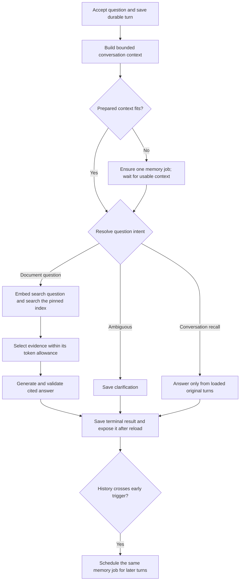

# Document conversations

Design checkpoint: November 12, 2026. **Proposed, not implemented.** The owner
requested a complete question/answer flow with persisted history, bounded context,
compression when needed, recovery and an explanation of scaling. One PDF per
conversation and the existing immutable index are accepted. The owner has now
accepted automatic history summaries and sharing the unchanged allowance across
question embeddings, rewriting, answers and memory calls. Hybrid timing and
stage-allowance reservations are accepted; precise chat model/token limits still
need compatibility and quality checks before live use.

## Outcome and example

Open an indexed PDF, ask a question, inspect the answer's source page, ask a
follow-up and return after reload. Conversations belong on the home screen;
processing Runs remains separate. An answer, a request for clarification and
an evidence limitation are useful outcomes. A provider failure is an execution
failure, displayed distinctly and retained in history.

With the existing FEMA document:

1. "How much coverage can apply to a detached garage?" retrieves the garage
   clause on physical page 5. Review its limit, the reduction in building coverage
   and its qualifications together.
2. "What if I use it for business?" needs the previous subject. A contextualizer
   makes the search question explicit: "Does the detached-garage coverage apply
   to business use?" It does not answer the question or change document scope.
3. Retrieve evidence again and answer from that evidence. Do not use the previous
   generated answer as proof of what the PDF says.
4. "No, I meant the main building" corrects the subject. Preserve that correction;
   do not let an older conversation summary override the current message.

These are development examples, not a policy interpretation or a quality pass.
Expected passages and qualifications need owner review before tuning. Keep some
questions held out and add another document before claiming broader quality.

## The three kinds of context

| Stored material | Purpose | Authority |
| --- | --- | --- |
| Complete ordered transcript | Reload history and inspect what was actually said | Original user messages and recorded assistant outputs; not proof of document facts. |
| Bounded recent exchanges plus conversation memory | Resolve subjects, corrections, constraints and unfinished questions | Derived, potentially lossy context; never a substitute for PDF evidence. |
| Freshly retrieved chunks and source links | Support this answer's factual claims | Evidence from the conversation's pinned revision/index, with known extraction gaps. |

Keep the PDF summary separate too. It is a document overview, not a conversation
memory or an independently verified evidence source.

## Flow and coordination

The first question can skip contextualization. Initially contextualize every
later question instead of using a brittle pronoun detector. Retain both original
and resolved question; the answer sees both. Ambiguity should produce a concise
clarification, not an invented referent. This costs one extra sequential call
for follow-ups; skipping it later needs measured quality and latency evidence.

The resolver's outcomes are `document_query`, `clarification` and
`transcript_request`. Conversation-only requests such as "What did I ask before?"
concern the stored transcript, not the PDF. The latter two outcomes bypass PDF
embedding and retrieval. A
bounded transcript-only response must use actual loaded turns; if the needed
older text is unavailable in context, clarify or expose the history limitation
rather than inventing it from a lossy memory. Do not add unrestricted history
search or an autonomous tool loop to this increment. Transcript claims reference
the loaded turn identities, not PDF citations, and cannot imply complete recall
of unloaded history.

Use a dedicated `chat` RQ queue and worker, reusing Redis. The existing single
worker handles parsing, summaries and indexing; priority alone cannot interrupt
a running parse. After the acceptance transaction commits, try immediate enqueue;
the database-backed dispatcher repairs a missed delivery. One bounded turn job
checkpoints successful paid stages instead of adding a dispatcher wait between
every stage. Save each validated output together with its exact input/version
identity. Its timeout and lease must cover the combined stage bounds. Propose
two worker attempts per turn, with no nested/adaptive provider retries.

One active turn per conversation keeps ordering unambiguous. Conversations can
be accepted independently; one chat worker executes one job at a time. Additional
chat workers permit concurrent execution across conversations. A second tab sends
the conversation head it last observed;
a stale head or another active turn produces a conflict the UI can explain.
Idempotency replay is checked first, so a repeated accepted request still returns
its original result even after the conversation advances. Changed text under
the same key conflicts. Preserve failed accepted questions in displayed history;
technical error text must not become assistant knowledge in later prompts.

## History options and recommendation

| Option | Benefit | Cost |
| --- | --- | --- |
| Send the full transcript | Simple for short chats; retains exact wording | Increasing tokens/latency and eventual overflow; more context does not guarantee useful recall. |
| Keep only recent exchanges | Cheap, predictable model input | Older subjects and corrections disappear from model context. |
| Recent exchanges plus a versioned summary of older exchanges | Bounded model input and continuity across longer chats | Additional calls, lossy compression and explicit failure handling. |

The owner accepted the third option. After the latency discussion, the owner accepted
**after-answer precomputation with a check before every new request**, rather
than always compacting on the answer path.

### When to run it

| Timing | Benefit | Cost |
| --- | --- | --- |
| Only before an oversized request | Simplest coordination; work is known to be needed | The triggering question waits for an additional model call. |
| Only after answers | Can overlap the user's reading time | A rapid or unusually large next turn can outrun it; no safety fallback. |
| After an early trigger, with a before-request fallback | Usually hides the work while still enforcing limits | One background job lifecycle and explicit race handling. |

The accepted hybrid is a small additional execution feature. It has one
summarizer and one durable job path, not separate background and inline engines.
After saving a terminal answer, check history size and save a memory-work intent
when the early trigger is reached. The response becomes available without waiting
for that job. Reuse PostgreSQL/RQ/Redis rather than an in-process fire-and-forget
task that can disappear on restart.

Use three validated history settings: an early trigger, a lower target after
compression, and a hard history allowance. Illustration only: trigger at 6,000
history tokens, aim for 3,000 after compression, and permit at most 8,000. These
are not selected defaults or percentages of the model's advertised window. The
gap leaves room for more exchanges and prevents recompressing after every answer.

Count the selected memory plus the raw suffix, not the entire archived transcript.
A new question, instructions, source labels, retrieved evidence, output allowance
and safety margin need separate room. A question within its own limit must be
accounted for before a provider call. A question larger than the supported input
bound is rejected clearly; history compression cannot shrink the current question.
Count actual serialized input again once evidence has been selected. Each model
stage has its own valid limits; a request that fits generation may not fit a
smaller contextualization stage.

### A concrete timeline

1. Answer 12 is saved. History crosses the early trigger. The background job
   snapshots older complete turns 1–8; turns 9–12 remain unchanged.
2. Question 13 arrives before compaction finishes. If the old memory plus its
   entire raw suffix and the prepared request still fit, proceed immediately.
   Freeze that context for turn 13; do not switch versions halfway through it.
3. Memory covering turns 1–8 finishes while turn 13 runs. Publish it against its
   expected predecessor version. Turn 13 keeps its selected context.
4. Question 14 can use the new memory plus raw turns 9–13. No new turn is lost.
5. If the next request instead cannot fit, it depends on the existing memory job.
   Do not launch a duplicate summarizer. If none exists, create the same job on
   demand. Bound the wait and job retries; report context-preparation failure if
   a valid result cannot be obtained. A later result may require another fit
   check: a summary of an old prefix does not guarantee enough room indefinitely.

A waiting question should remain durably pending on that dependency, not hold a
long database transaction or HTTP connection. Resume it when the memory is
ready. Recovery handles a lost delivery. There is no unbounded compression loop
or automatic repeated retry of an already failed prefix.

### What is saved and what can go wrong

Keep every original message in PostgreSQL. Each immutable memory stores its
predecessor version, exact covered-through sequence, prompt/model versions and a
bounded payload: subjects, constraints, corrections, unresolved questions and
references to original turns. Subsequent summaries combine the previous memory
with the newly eligible old prefix; they do not reread the whole transcript.
Repeated summaries can still lose nuance, so original turns remain necessary
for exact recall and quality review.

Only earlier terminal turns can enter a compaction prefix, never a pending
question. Keep recent complete exchanges raw. Failed user questions may enter
as explicitly unanswered questions; omit technical error text. A current user
correction has precedence over an older summary. No memory or prior answer is
independent evidence for a PDF claim.

Allow one pending/running memory job per conversation, with a stable input
identity and ownership checks. An advancing conversation head does not invalidate
an immutable prefix; later turns remain in the raw suffix. Reject publication
against the wrong predecessor or an older prefix than the active memory. Store
successful output before making it available. Duplicate delivery cannot create
another accepted job, but worker loss/timeouts can still make provider billing
uncertain; do not promise exactly-once paid execution.

If compaction fails, retain the previous memory and all original turns. Continue
with unchanged context only while it fits. A malformed, oversized or insufficiently
reducing summary is not silently substituted. Bound the compactor's own input,
output, retries and total waiting time. If a recent indivisible exchange cannot
fit, expose the limitation instead of dropping it.

### Resources, cost and the limits of background work

A memory job on the only chat worker can delay the next question even after the
previous answer is displayed. For actual overlap, propose one separate lightweight
memory worker, reusing the API image and existing Redis/database; it does not need
Docling. A priority queue alone cannot preempt a running job. Additional workers
still share CPU, database connections, provider quotas and the spending allowance.

Run only after token pressure, not after every answer or on a periodic timer.
One queued job can combine pending needs before its input is frozen; a running
job's input stays immutable. Background compaction can be wasted if the user
never returns. It must also leave allowance for foreground work: a previously
started provider call cannot surrender its reservation just because a question
arrives. The accepted stage-allowance reservation removes the previous
full-context hold, but concrete answer/memory limits and the foreground reserve
still need selection. A job may need to stay pending and the fallback may add delay.

Measure compaction duration, how often questions actually wait, tokens before
and after, calls/cost and lost-detail failures. Do not claim a latency improvement
until observed. The proposal normally overlaps work with reading time; it cannot
guarantee that every future question avoids a pause.

## Retrieval and answer contract

Use the index's embedding model and dimensions for the question. Filter exact
pgvector search by the pinned `index_id`; never retrieve globally and filter only
afterward. Bound candidate count and final evidence tokens, retain deterministic
ordering, and save which chunks actually reached the answer model. Start with
the selected dense baseline; compare lexical retrieval on exact identifiers and
numbers before deciding on hybrid search or a reranker.

An answer can cite only labels for the supplied evidence, not any arbitrary
element in the PDF. Resolve those labels to the existing whole-element page
locations. Validate structure, bounds and citation membership before publication;
those checks cannot prove semantic support. Evaluate whether the correct passage
was retrieved separately from whether the answer preserved its qualifications.

Use a bounded answer with cited claims, or a clarification/evidence-limitation
outcome. Attribute contradictory passages rather than silently choosing one.
Low similarity is not a truth threshold. A retrieval miss means evidence was not
found in the supplied passages; it does not prove the original PDF lacks it.
Known extraction gaps remain visible. Document text, history and compressed
memory are untrusted data and cannot change the system instructions or scope.

## Context, spending and latency

The accepted [reservation correction](ai-budget.md) is the immediate prerequisite:
reserve Folio stage allowances rather than advertised model capacity, with honest
estimate-based guarantees, late-billing settlement and versioned legacy behavior.
It is implemented separately from conversation behavior.

The assembled request must fit all applicable limits:

`instructions + schema + question + memory + recent history + evidence + framing margin`

must stay within the configured input allowance and any verified provider prompt
ceiling. A missing prompt ceiling is not unlimited capacity; the current DeepSeek
route leaves it unspecified. Add reserved output, including reasoning where applicable, and check
the combined context ceiling too. History and evidence allowances partition the
input; they are not extra capacity. Keep short prose targets separate from a
generous completion ceiling, and never publish a response cut off mid-generation.

A first document question normally needs one embedding and one generation call.
A follow-up adds question resolution; a long-history turn may also add compression.
Do not summarize, rerank, judge and retry adaptively on every question. Record
queue wait, context/compression, rewrite, embedding, database search, generation,
validation, total time and token/cost observations separately. A small exact
database search is not necessarily the dominant delay; measure before optimizing.

All new paid stages must join the existing spending ledger. A successfully
committed stage is reused after a worker restart. If the provider finishes but
the worker dies before committing, the outcome is uncertain and a bounded retry
may charge again. Uncertain calls retain reservations; late known
bills settle even when the old worker cannot publish. No exactly-once provider
billing guarantee follows. New generation policies reserve the configured stage
input allowance plus maximum output. This remains an estimate-based spending
control; don't invent an exact tokenizer or assume a gateway hard dollar cap.

Current model research favours the existing DeepSeek V4.1 Flash 1017/Together
route as the first compatibility candidate for all three generation jobs. It
already has a pinned tokenizer and supported route; neither its answer,
rewriting nor memory quality is established. Luna has lower advertised unit
prices but needs verified token accounting and tier/cache-write support; Haiku
also needs a new provider boundary. Changing an environment value is insufficient.

The legacy full-ceiling policy would reserve $0.319488 for a DeepSeek call
with a 4,096-token completion cap. Under the unchanged $0.40 document allowance,
that prevents admission once known spending plus held amounts exceeds $0.080512.
For comparison, exactly 16,384 billed input tokens and 4,096 output tokens at
the current $0.30/$1.20 per-million rates would cost $0.0098304. The latter is
illustrative arithmetic, not a hard billing bound or measured chat cost.

The owner selected fixed stage input allowances plus maximum output, accepting
the uncertainty without raising allowances. The illustrative token limits still
need agreement before paid chat. Successful stage checkpoints can
avoid repeat payment after a failure but cannot guarantee funds for later stages.

Prompt caching is optional provider reuse of a matching prefix. It neither
removes tokens from the context window nor creates durable conversation memory.
Put stable instructions first, observe actual cache usage, and reserve without
assuming cache discounts. Explicit cache writes can cost more than ordinary
input. No semantic response cache, Redis chat-memory cache or streaming is needed
for the first complete flow. Show truthful processing state and publish the
validated final answer; streaming needs separate provisional-content semantics.

## Small persistence and HTTP surface

| Relation | Responsibility |
| --- | --- |
| `conversations` | Pinned index, creation identity/time and ordered head. |
| `conversation_turns` | Sequence/parent, immutable question, idempotency/hash, frozen policy/context, lifecycle and bounded terminal result. |
| `turn_attempts` | Ownership, delivery, retries, timing and safe failures. |
| `turn_invocations` | Paid stage identity, reservation, observed billing and successful-stage checkpoint. |
| `turn_evidence` | Supplied evidence label/rank, scoped chunk reference and retrieval score. |
| `conversation_memories` | Versioned bounded summary and exact covered prefix. |

Use foreign keys to prevent cross-conversation/index references; a partial unique
constraint prevents two active turns. The `(conversation_id, sequence)` index
serves ordered history and cursor pagination. It does not require indexing every
combination of columns. The existing chunk key begins with `index_id`, allowing
the database to narrow to one index before comparing vectors. Inspect
`EXPLAIN (ANALYZE, BUFFERS)` on representative data before adding indexes.

Proposed routes: create/list/read conversations; submit a turn; read/poll a turn;
page through turns by immutable sequence. Reuse existing source/PDF routes.
Conversation lists initially use stable creation-time cursors; sorting by last
activity requires an explicit live-list pagination contract. A turn is the user
question plus its eventual assistant outcome; do not introduce separate message
and generic workflow systems without a need.

Group implementation in one `conversations/` feature, with acceptance/read,
context preparation, retrieval, processing/lifecycle and prompt/schema concerns.
Reuse the existing provider, budgeting, database and diagnostics where their
contracts fit. Add only the small changes those contracts need. No agent runtime,
provider registry, universal memory interface or extra retrieval service.

The minimal UI reuses the document reader and source-page navigation. Add a chat
view with persisted messages, a question field, a real pending/failure state and
citation buttons; keep the existing content view reachable. Home lists saved
conversations with bounded pagination and an upload entry. Activity shows stage
timings, context counts/memory version, supplied evidence identities and billing.
No simulated progress or raw document/credential logging is introduced.

## Verification and scaling questions

Use three interfaces for test-first work: HTTP-to-persisted conversation/evidence;
real database/queue lifecycle with controlled providers; provider request/result
validation. Add one behavior at a time: one cited answer and reload, follow-up,
then compression and failure recovery. No paid model calls in deterministic tests.

Essential failures: replay after a later turn, conflicting replay, concurrent
tabs, cross-index evidence, malformed/unknown citations, context overflow,
compression failure, lost worker after a successful paid stage, stale publication
with late billing, Redis outage and budget exhaustion. Review paraphrases,
corrections, ambiguous references, absent information and embedded instructions
against human-checked passages. Model stubs cannot establish answer quality.

Useful design questions to practise, not a prediction of any interview:

- If two workers receive the same turn, which database condition allows one to
  claim it? Why must no database lock stay held during a provider call?
- If the API response is lost, how does replay return the original turn without
  another paid call? How is that different from a timed-out provider request?
- What survives after rewriting succeeds but generation fails?
- Why does the model need fresh PDF evidence after a previous cited answer?
- Which context detail could compression lose, and how would the UI be honest?
- With more users, which limit comes first: provider quota, worker slots,
  database connections, queue wait or vector-search latency?

Scale worker counts across conversations, not simultaneous turns in one
conversation. Bound admission, provider concurrency and database pools together.
The one shared budget lock/aggregate query is deliberately small-scale; higher
throughput would justify account-scoped counters/ledgers. Approximate vector
indexes need measured scoped latency/recall evidence. Multi-user hosting also
requires authentication and tenant filters at every read/write/retrieval path;
public source does not authorize a public service.

## Primary research

Checked November 12 through Aside. These support patterns and tradeoffs, not one
universal industry standard or measured Folio accuracy:

- [LangChain short-term memory](https://docs.langchain.com/oss/python/langchain/short-term-memory): durable state, token trimming and summarization.
- [History-aware retrieval](https://reference.langchain.com/python/langchain-classic/chains/history_aware_retriever/create_history_aware_retriever): contextualize a follow-up before retrieval; currently a classic API, not a selected dependency.
- [LlamaIndex condense-question](https://developers.llamaindex.ai/python/examples/chat_engine/chat_engine_condense_question): standalone search questions and limitations of always querying documents.
- [LlamaIndex Memory](https://developers.llamaindex.ai/python/framework/module_guides/deploying/agents/memory): token budgets and selected memory blocks; flushing alone does not mean summarization.
- [Anthropic context engineering](https://www.anthropic.com/engineering/effective-context-engineering-for-ai-agents): useful context selection and lossy compaction.
- [Anthropic background compaction](https://platform.claude.com/docs/en/build-with-claude/compaction-background): captured prefix, one pending operation, retained new turns and headroom while work runs.
- [Anthropic threshold compaction](https://platform.claude.com/docs/en/build-with-claude/compaction-threshold): compaction before answering within a request; provider-specific beta, not assumed OpenRouter functionality.
- [LangChain summarization middleware](https://reference.langchain.com/python/langchain/agents/middleware/summarization/SummarizationMiddleware): both synchronous and async hooks run before model invocation; async does not mean detached background work.
- [OpenRouter prompt caching](https://openrouter.ai/docs/guides/best-practices/prompt-caching): prefix reuse, route dependence and write/read pricing.
- [Selected DeepSeek route](https://openrouter.ai/api/v1/models/deepseek/deepseek-v4.1-flash-1017/endpoints): observed prices and capacity behind the reservation example.

Frameworks provide useful components but do not supply Folio's ownership,
spending, source-scope and publication contracts. Reconsider a small library
integration only when it replaces demonstrated machinery with a clearer contract.
