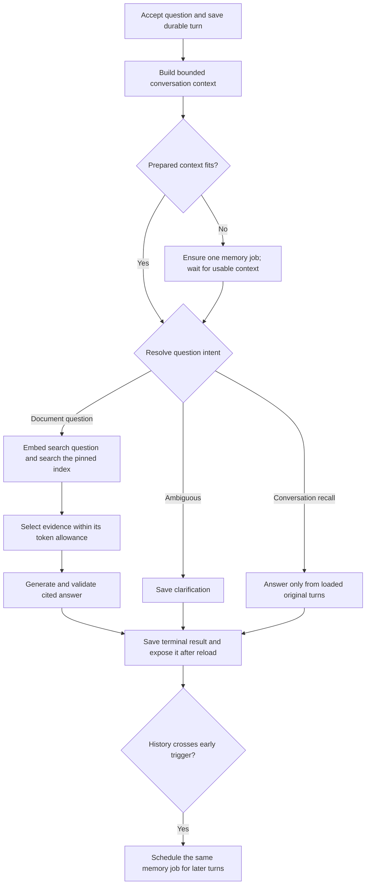

# Document conversations

Design checkpoint: November 13, 2026. **Saved follow-ups and hybrid memory are implemented.** The owner
requested a complete question/answer flow with persisted history, bounded context,
compression when needed, recovery and an explanation of scaling. One PDF per
conversation and the existing immutable index are accepted. The owner has now
accepted automatic history summaries and sharing the unchanged allowance across
question embeddings, rewriting, answers and memory calls. Hybrid timing and
stage-allowance reservations are accepted. Initial chat model/token limits below
passed a read-only compatibility check; quality is evaluated separately.
The [memory walkthrough](conversation-memory.md) covers its implemented flow,
storage, debugging and remaining quality limitations.

## Reading answers — November 13

The accepted polish keeps the composer below a separately scrolling transcript.
Enter submits; Shift+Enter inserts a newline, and IME composition must never
submit accidentally. The input starts compact, grows to a bounded height and then
scrolls internally. Submission, retry and draft ownership retain their existing
contracts. The small AI notice stays below the composer; known extraction
limitations are available in source details and the document view, without a
separate composer banner.

Markdown is a presentation choice, not a new answer schema or prompt. Render
formatting without raw HTML or remote images. Preserve each statement's source
references and show up to five passage previews below the answer. The source
drawer presents the full cited set and opens physical PDF pages. It reuses the
saved turn response rather than performing retrieval again.

The later November 13 refinement places small rounded citation controls inline
with each statement's final paragraph; lists, tables and code keep their block
structure. A truthful pending/context-preparation indicator accompanies waiting.
New answers follow the bottom while the reader remains near it. Scrolling up or
opening an earlier exchange pauses following; Latest reply resumes it. Sending
a question also resumes following. Earlier-history pagination keeps its anchor.
The sidebar's New conversation action opens the document-selecting composer;
selection covers the full row, including its separate menu button.

For example, an answer may cite S1 for a garage limit and S3 for an exclusion.
The backend returns those two original chunk texts and their page locations.
The drawer shows both passages; numbered references keep the statement-to-passage
connection visible. Another exchange's S1 is a different reference. Neither
identifier proves semantic support: the reader still checks the actual wording.

Owner exercise: open a saved answer, inspect a passage and its original page,
close the drawer with Escape, then scroll to an older exchange without moving
the composer. In the Network response, compare `answer.statements[].source_ids`
with `citations`. Display changes belong in the frontend; missing or incorrect
retrieved evidence belongs in retrieval/evaluation, not in source-chip styling.

## Original first-answer increment

The owner selected one question and its terminal answer per saved conversation,
with follow-ups and the accepted hybrid memory behavior in the next increment.
The original UI stated this temporary boundary and offered a new chat, never accepting a
second question while silently ignoring history. Saved conversations live in a
desktop sidebar or a mobile drawer; Runs remains processing history. The source
reader remains accessible, and home opens a document.

Use `openai/gpt-5.2` on OpenRouter's `openai` route,
reasoning off, 16,384 input tokens and 4,096 maximum output tokens. These are
configurable initial limits, not a general answer-quality guarantee.
Public metadata preflight passed; the current generation reservation is
$0.086016 at the observed rates. Question embeddings use the pinned index model.
Existing cumulative/document allowances are unchanged. Accounting surrounds paid
execution; retrieval, source selection and prompt preparation know no dollar
account. Subscriptions and account abstractions are outside this increment.

Start with exact cosine search of only the pinned ready index, six chunks at
most, followed by a complete-input token check. Return a short cited answer,
clarification or insufficient-evidence outcome. Save actual supplied chunks;
validate citation membership and retain known extraction gaps. No silent input
truncation, similarity-as-truth threshold, reranking or streaming.

## Accepted conversation completion — November 12

The owner requested the next complete conversation experience. Implementation
proceeds through passing checkpoints, using the existing HTTP/persistence,
worker/provider and mocked-browser test interfaces:

1. Entry/composer: Home offers New chat and Upload, with separate routes. A shared
   rounded textarea grows before scrolling internally. New chat selects a ready
   document inside the composer; the first deliberate Send creates/submits with
   durable replay keys. Keep one document/index fixed afterward. Remove the
   duplicate header glyph. No model calls are needed to verify this checkpoint.
2. Identity/management: generate a brief title in the first answer call, persist
   it with the result, and provide rename/delete actions. Manual rename wins over
   delayed title generation. Legacy/failed chats use a deterministic fallback.
3. Follow-ups: accept ordered turns against the caller's observed head, freeze
   bounded history, resolve follow-up intent, retrieve fresh evidence and retain
   all messages/failures on reload. The composer stays available. Source labels
   are scoped to their owning turn. Do not remove the one-turn restriction until
   the complete context path works.
4. Long history: implement the accepted durable background memory path and the
   before-request fallback, then verify the end-to-end flow and actual costs.

Accepted Delete behavior removes the chat from public navigation/read routes and
prevents new work/publication, retaining internal transcript, diagnostics and
billing records. Explain that retention in the confirmation. Already-started
provider calls may still finish and bill; settlement must remain possible, but
the chat cannot reappear or publish an answer. This is not permanent erasure.

The owner accepted GPT-5.2 for contextualization and memory too, sharing the
unchanged allowance. Report actual live charges separately from estimates.
At the verified $1.75/M input and $14/M output rates, 1,500 input plus 120 output
tokens for rewriting is about $0.0043; 6,000 plus 500 for memory is about $0.0175.
These are illustrations, not measurements or guarantees. Titles add a small
field to the first answer response, not a separate inference call.

Accepted configurable history defaults: background trigger 6,000 tokens, target
roughly 3,000 after compression, hard allowance 8,000; preserve the two most recent
exchanges unchanged. The target guides prefix selection rather than permitting
partial-message truncation. Actual assembled requests still undergo model/stage
fit checks. Background work must leave allowance for foreground answering.
Lossy memory never becomes document evidence or a substitute for original turns.

### Titles and removing chats

The first answer requests a short topic title in the same provider response.
The answer and usable title publish in one transaction. Title metadata is
auxiliary: if unusable, keep the valid cited answer and fall back to a shortened
first question or document name. This fallback also covers existing chats.

`PATCH /conversations/{id}` accepts `title` and `expected_version`. Imagine two
tabs both reading version 0: the first save creates version 1; the second receives
a conflict and keeps its typed title for review. A short row lock protects that
comparison and update. The lock lasts for database work, not for model generation
or the time a person spends editing. Generated titles never overwrite a manual
rename and do not advance the manual-edit version.

`DELETE /conversations/{id}` sets a deletion timestamp and cancels unfinished
work. Normal reads exclude that chat, while the internal records remain available
to accounting. A provider call already admitted may still finish: its charge is
saved, but its answer and title cannot publish. Replaying the original creation
key cannot restore the chat. Repeating Delete is safe.

Owner exercise: open the same chat in two tabs, rename it in one, then save an
older edit from the other. Find the HTTP 409 response in browser developer tools.
Explain why blindly retrying with the newest version would erase the protection.

### Follow-up contract

`POST /conversations/{id}/turns` adds `observed_head`: the sequence of the latest
exchange the caller loaded (0 for an empty chat). Under the conversation lock,
the API first checks the submission key, then checks that head and that no answer
is already running. Exact replay returns the original turn even after later
messages exist. A different question or head under the same key conflicts.

The saved turn records its `parent_sequence`, original question, frozen context
and successful resolution. A document question embeds the resolved search query,
retrieves fresh evidence and answers using both original and resolved questions.
Clarification and transcript recall finish from the resolution call without PDF
search. Transcript references point to loaded original exchanges, separately from
PDF citations. Failed questions remain visible and enter later context as unanswered.

The history route defaults to the latest 20 exchanges in chronological display
order. `before_sequence` requests an earlier page and `next_before` reports its
cursor. Explicit `after` pagination remains available; callers cannot combine
both cursors. Conversation metadata adds `head_sequence`; it does not replace
loading the actual messages before submitting a follow-up.

The resolver uses GPT-5.2 with 16,384 input and 1,024 output tokens, configurable
separately under `FOLIO_CHAT_REWRITE_*`. The unchanged answer limits are
16,384/4,096. `FOLIO_CHAT_HISTORY_LIMIT_TOKENS=8000` bounds conversation context;
complete provider requests are checked separately. The existing gated development
trace exposes the saved context/hash, resolved question, supplied evidence and
per-stage charges. Normal chat reading need not show those execution details.

The existing unique `(conversation_id, sequence)` database index serves three
jobs: prevent duplicate positions, find the newest exchange in one conversation,
and fetch earlier pages. For `WHERE conversation_id = ? AND sequence < ? ORDER BY
sequence DESC LIMIT 20`, PostgreSQL can narrow to one conversation and walk that
index backward. We do not need a separate index for each combination of those
columns. An unrelated query filtering only by sequence has a different access
pattern and would need its own measured justification.

Owner exercise: open two tabs at the same conversation position and send two
different questions. One should be accepted; the other should retain its draft
and ask you to reload. Compare the HTTP 409 with a retry after a network failure:
the latter reuses its submission key so it cannot create a second accepted turn.

Accepted test interfaces extend the existing HTTP/persistence, database/worker
lifecycle and provider contracts. Test one saved cited answer first, then replay,
scope isolation, malformed/truncated output and recovery. Model responses are
controlled in software tests; real answer support is reviewed separately.

HTTP/UI contract for the original one-answer increment (retained for older saved
policies; the follow-up checkpoint extends it):

- `POST /conversations` with `{index_id}` and `Idempotency-Key` returns a saved
  conversation; `GET /conversations?before=<id>&limit=20` lists newest created
  conversations with `items` and `next_cursor`.
- `GET /conversations/{id}` returns `id`, `document_id`, `revision_id`, `index_id`,
  `document_name`, `created_at`, `question`, `state`, and `max_turns: 1`.
- `POST /conversations/{id}/turns` with `{question}` and `Idempotency-Key` saves
  and returns a pending turn; exact replay returns the same turn; changed text
  or a second question conflicts.
- `GET /conversations/{id}/turns?after=0&limit=20` returns ordered `items` and
  `next_after`; `GET /conversations/{id}/turns/{turn_id}` polls a saved turn.
- A turn contains `id`, `conversation_id`, `sequence`, `question`, `state`,
  timestamps, nullable `error: {code,message}`, nullable `answer`, `citations`,
  and `coverage: {pages_without_content,diagnostics}`. States are `pending`,
  `running`, `ready`, `failed`, `unavailable`. Answer is
  `{outcome: answer|clarification|insufficient_evidence, statements: [{text,source_ids}]}`.
  Citation entries contain `source_id` (a supplied label such as S1),
  `chunk_ordinal`, `text`, and `pages`. Labels resolve to the saved supplied chunks,
  whose existing source links identify original elements/pages.
- Development-only `GET /development/conversation-turns/{id}` exposes safe
  attempts, invocation usage/costs and retrieved identities for debugging.

Use a dedicated chat queue/worker, immediate enqueue after commit and durable
dispatcher recovery. Two attempts maximum; successful paid-stage checkpoints are
reused. Failed accepted questions remain in history. A late response can settle
its bill but cannot publish after losing ownership.

## First-answer reading order

For “How much coverage can apply to a detached garage?”, the browser saves a
conversation tied to the ready PDF index, then saves the question. The API returns
immediately after a bounded queue-delivery attempt. The dedicated chat worker
embeds the question once, ranks chunks from that one index, and saves the six
selected passages. The answer model sees the question, those passages and known
extraction gaps. It does not receive the complete PDF or the document summary.
The model returns cited statements or an explicit evidence/ambiguity limitation.
Folio checks the response shape and cited identities before publishing it.

| File under `src/folio/conversations` | Responsibility |
| --- | --- |
| `routes.py` | Accept/replay a question, list conversations and read saved results. |
| `processing.py` | Coordinate one claimed question through the two paid stages. |
| `retrieval.py` | Rank only the pinned index and save the actual selected chunks. |
| `preparation.py` | Build the question/evidence prompt and validate the returned answer. |
| `queries.py` | Read the conversation, evidence, citations and extraction gaps. |
| `lifecycle.py`, `dispatcher.py` | Claim work, recover interruptions and repair queue delivery. |
| `invocations.py` | Reserve/settle paid calls without deciding what to retrieve or say. |

Five tables have distinct reasons to exist. `conversations` pins an index;
`conversation_turns` stores the question and saved answer/checkpoints;
`turn_evidence` links the selected chunk identities and their rank;
`turn_attempts` records each execution; `turn_invocations` records each paid call.
Source text and PDF bytes remain in their existing stores. Composite foreign keys
prevent an evidence link from crossing the turn's index. An index and extraction
are immutable, so links keep meaning after reload.

A transaction is a small all-or-nothing database change. Accepting a question and
its processing intent is one transaction. Publishing an answer and its known bill
is another. Network/model calls run **outside** transactions. Two tabs briefly lock
the same conversation row while accepting a question; unrelated conversations
do not need that row. The shared deployment spending row briefly serializes paid
admission/settlement, never the model's generation time. It remains a measurable
shared bottleneck at higher traffic, not a claim of unlimited throughput.

If Redis is down, the saved question remains pending and the dispatcher retries
delivery. If generation times out, its charge is uncertain and retains its hold;
a bounded second attempt reuses the saved question vector and evidence. If a worker
dies, its lease eventually expires and another worker can claim the work. An old
worker returning later may settle its bill but cannot overwrite the new result.
This is at-least-once execution with guarded publication, not exactly-once billing.
Two attempts are allowed; invalid citations/truncation are terminal rather than
adaptive prompt retries. All accepted failures remain reloadable.

`conversations_created` supports newest-first cursor pagination. The partial
`turns_due` and `turns_expired` indexes contain only work needing delivery/recovery.
Existing `(index_id,ordinal)` chunk keys narrow retrieval before exact distance
ranking. There is no approximate vector index: with a small selected document,
exact search is simple and inspectable. Measure filtered retrieval with
`EXPLAIN (ANALYZE, BUFFERS)` and representative documents before adding HNSW or
another retrieval store. Adding workers does not make that SQL faster.

Owner exercise: open one answer's development trace and find its index, six ranked
chunks, two invocation records and final citations. Explain why six retrieved
passages can yield only one cited passage, then compare the cited statement with
the original page. Citation membership is checked in code; semantic support still
needs evaluation. No broad quality claim follows from one example.

## First live observations

The fixed public FEMA October 2021 Dwelling Form remains the evaluation input;
Docling 2.148.0 extraction, merged 512-token chunks and the pinned 1,536-dimensional
OpenAI small embedding index were reused. Prompt/schema/retrieval versions are 1.
Two manual questions used DeepSeek V4.1 Flash 1017/Together with reasoning off,
16,384 input and 4,096 output limits, no prompt tuning and no adaptive retries.

| Observation | Retrieval | Generation |
| --- | --- | --- |
| Garage amount and conditions | Relevant chunk 10 ranked first; its original clause is on physical page 5. | Non-answer with citations violated the response contract; no answer published. 2,712 input/65 output tokens, $0.00089160 generation. |
| Whether garage coverage increases the building limit | Relevant chunk 10 ranked first again. | Structurally valid citation, but incorrect “Yes” contradicted both its explanation and the source's reduction clause. 2,517 input/57 output tokens, $0.00082350 generation. |

Server acceptance-to-terminal times were approximately 4.6 and 5.2 seconds on these
runs, not a latency benchmark. Question embeddings cost $0.00000060 in total.
The first rejected output's full text was not retained; its precise wording cannot
be reconstructed from safe diagnostics. An independent reviewer established the
second expected answer from the source before reading the output and confirmed
that generation failed. This is agent review, not owner acceptance or a general
quality metric. Keep the errors visible; do not auto-correct “Yes” with a rule or
weaken citation validation. Model/prompt improvement needs a separate comparison
including held-out questions and another document before broader claims.

### Approved comparison

The owner then approved comparing `openai/gpt-5.2` on OpenRouter's `openai` route,
reasoning `none`, with the same prompt, six-chunk retrieval and token allowances.
The two repeated questions retrieved exactly the same chunk order as before.
A third question asked for a personal policy number unavailable in the supplied
standard form excerpts. No adaptive retry, automatic answer correction or prompt
tuning was added.

| GPT-5.2 question | Observed outcome | Generation cost |
| --- | --- | --- |
| Garage amount and conditions | Preserved <=10%, location, optional use/reduced building limit, residential/business/farming exclusions. Its separately qualified Coverage D garage/carport exclusion is supported on page 12. | $0.00688800 |
| Whether using garage coverage increases the building limit | Correctly answered No, with the reduction and 10% ceiling cited. | $0.00555800 |
| Personal policy number | Insufficient evidence, no invented number or citations; limited its statement to the available excerpts. | $0.00499975 |

Independent source review found all three outputs supported. These are diagnostic
observations, not a held-out benchmark, broad quality guarantee or owner acceptance
of each answer. The comparison used $0.01744647 including query embeddings. At
observed $1.75/M input and $14/M output, the full answer hold is $0.086016; a hold
is temporary allowance, not the actual charge. Both models used less than their
reserved amounts. After this comparison, the owner accepted GPT-5.2 as the answer
default on November 12. This changes newly accepted questions; existing turn
policies and answers remain intact. Summary and embedding settings, prompts,
retrieval and spending allowances are unchanged.

## Follow-up development sequence — November 13

The owner selected five questions using the same public FEMA PDF/index. New
turns used answer prompt/schema 3, retrieval policy 2 and the initial resolver
prompt. GPT-5.2/OpenAI, reasoning off, served answers and resolution; embeddings
were unchanged. These were real browser submissions, without automatic prompt
retries. An independent review compared outputs with previously checked source
expectations.

| Question | Observed behavior | Known cost, including all stages |
| --- | --- | --- |
| Detached garage amount | Supported 10% ceiling, optional use, reduced building limit and exclusions; supporting chunk ranked first. | $0.00630370 |
| Business-use follow-up | Correctly resolved the garage and cited its exclusion. The search query added unsupported “Other Structures” terminology. | $0.00844555 |
| Correction to main dwelling | Correctly distinguished the garage sublimit from dwelling coverage, but the query again added an unsupported classification. | $0.00917518 |
| Personal policy number | Safely invented no number, but asked for clarification based on missing chat information without searching the available PDF, and suggested an unsupported image workflow. | $0.00233275 |
| Quote the first question | Exact quotation with the correct original-turn reference and no PDF calls; unnecessarily exposed an internal turn identifier in prose. | $0.00281050 |

Total known cost was $0.02906768, with no uncertain holds. Acceptance-to-terminal
times were 4.39–10.94 seconds in these five runs, not a latency benchmark. The
first three answers use the same clause on physical page 5 (chunk spans 5–6).
All six candidates fit each document answer, maximum supplied history was 480
tokens, and the known page-2 extraction gap remained visible. This does not
evaluate long-history compression, broad retrieval quality or a held-out set.

These observations motivate one general resolver-prompt revision: distinguish
an unclear question from a factual answer absent from history, use the already
selected PDF for factual lookup, avoid invented categories and keep reference
identifiers out of prose. Saved policies retain the original instructions. A
comparison is development-set tuning and must not replace these original results.

The revised five-turn run cost **$0.03034205**, including question embeddings.
All charges are known; both follow-up runs together cost $0.05940973. The original
and revised runs remain separate saved conversations and ignored local traces.

| Revised check | Observation |
| --- | --- |
| Garage amount/business use | Both answers preserve the source conditions; chunk 10 still ranks first. The business-use query no longer invents a coverage category. |
| Correction to main dwelling | Answer correctly distinguishes the garage limit from dwelling coverage. The query still adds “other structure”; this unsupported expansion remains a known limitation. |
| Personal policy number | Searches the selected PDF, then reports that the supplied passages cannot identify the number. Independent review checked all six retrieved chunks. |
| First-question quotation | Exact original wording, correct original-turn link, no internal ID in prose and no PDF calls. |

Answer prompt/schema remain version 3, retrieval version 2; new resolver policies
save `rewrite_prompt_version=2`. Older frozen policies keep their original prompt.
This is one generic prompt change after observing development examples, not a
held-out quality benchmark. Maximum revised history was only 468 tokens: neither
run establishes long-history memory quality or the evidence-dropping path.

A host WSL restart interrupted the revised first question before paid admission.
After restoration, PostgreSQL still held the question; lease expiry and bounded
recovery produced one admitted embedding/answer attempt without resubmission.
This does not exercise recovery after an uncertain provider bill. All five turns
and their generated title survived reload. Real browser checks confirmed PDF
page rendering and original-exchange focus. Inspection subsequently found a
second document scrollbar caused by an uncontained hidden input label. Making
the reader its positioning container fixed the measured overflow: document
height now equals the viewport at 1440×1000 and 390×844, while the reader still
scrolls. Two observed failing UI regressions now pass, and sixteen affected
chat/navigation checks, types, formatting and build pass. Aside rechecked the
header, original-turn focus and rendered PDF after the production web rebuild.

## Outcome and example

Open an indexed PDF, ask a question, inspect the answer's source page, ask a
follow-up and return after reload. Saved conversations remain available beside
the active view; processing Runs stays separate. An answer, a request for clarification and
an evidence limitation are useful outcomes. A provider failure is an execution
failure, displayed distinctly and retained in history.

With the existing FEMA document:

1. "How much coverage can apply to a detached garage?" retrieves the garage
   clause on physical page 5. Review its limit, the reduction in building coverage
   and its qualifications together.
2. "What if I use it for business?" needs the previous subject. A contextualizer
   makes the search question explicit: "Does the detached-garage coverage apply
   to business use?" It does not answer the question or change document scope.
3. Retrieve evidence again and answer from that evidence. Do not use the previous
   generated answer as proof of what the PDF says.
4. "No, I meant the main building" corrects the subject. Preserve that correction;
   do not let an older conversation summary override the current message.

These are development examples, not a policy interpretation or a quality pass.
Expected passages and qualifications need owner review before tuning. Keep some
questions held out and add another document before claiming broader quality.

## The three kinds of context

| Stored material | Purpose | Authority |
| --- | --- | --- |
| Complete ordered transcript | Reload history and inspect what was actually said | Original user messages and recorded assistant outputs; not proof of document facts. |
| Bounded recent exchanges plus conversation memory | Resolve subjects, corrections, constraints and unfinished questions | Derived, potentially lossy context; never a substitute for PDF evidence. |
| Freshly retrieved chunks and source links | Support this answer's factual claims | Evidence from the conversation's pinned revision/index, with known extraction gaps. |

Keep the PDF summary separate too. It is a document overview, not a conversation
memory or an independently verified evidence source.

## Flow and coordination

The first question can skip contextualization. Initially contextualize every
later question instead of using a brittle pronoun detector. Retain both original
and resolved question; the answer sees both. Ambiguity should produce a concise
clarification, not an invented referent. This costs one extra sequential call
for follow-ups; skipping it later needs measured quality and latency evidence.

The resolver's outcomes are `document_query`, `clarification` and
`transcript_request`. Conversation-only requests such as "What did I ask before?"
concern the stored transcript, not the PDF. The latter two outcomes bypass PDF
embedding and retrieval. A
bounded transcript-only response must use actual loaded turns; if the needed
older text is unavailable in context, clarify or expose the history limitation
rather than inventing it from a lossy memory. Do not add unrestricted history
search or an autonomous tool loop to this increment. Transcript claims reference
the loaded turn identities, not PDF citations, and cannot imply complete recall
of unloaded history.

Use a dedicated `chat` RQ queue and worker, reusing Redis. The existing single
worker handles parsing, summaries and indexing; priority alone cannot interrupt
a running parse. After the acceptance transaction commits, try immediate enqueue;
the database-backed dispatcher repairs a missed delivery. One bounded turn job
checkpoints successful paid stages instead of adding a dispatcher wait between
every stage. Save each validated output together with its exact input/version
identity. Its timeout and lease must cover the combined stage bounds. Propose
two worker attempts per turn, with no nested/adaptive provider retries.

One active turn per conversation keeps ordering unambiguous. Conversations can
be accepted independently; one chat worker executes one job at a time. Additional
chat workers permit concurrent execution across conversations. A second tab sends
the conversation head it last observed;
a stale head or another active turn produces a conflict the UI can explain.
Idempotency replay is checked first, so a repeated accepted request still returns
its original result even after the conversation advances. Changed text under
the same key conflicts. Preserve failed accepted questions in displayed history;
technical error text must not become assistant knowledge in later prompts.

## History options and recommendation

| Option | Benefit | Cost |
| --- | --- | --- |
| Send the full transcript | Simple for short chats; retains exact wording | Increasing tokens/latency and eventual overflow; more context does not guarantee useful recall. |
| Keep only recent exchanges | Cheap, predictable model input | Older subjects and corrections disappear from model context. |
| Recent exchanges plus a versioned summary of older exchanges | Bounded model input and continuity across longer chats | Additional calls, lossy compression and explicit failure handling. |

The owner accepted the third option. After the latency discussion, the owner accepted
**after-answer precomputation with a check before every new request**, rather
than always compacting on the answer path.

### When to run it

| Timing | Benefit | Cost |
| --- | --- | --- |
| Only before an oversized request | Simplest coordination; work is known to be needed | The triggering question waits for an additional model call. |
| Only after answers | Can overlap the user's reading time | A rapid or unusually large next turn can outrun it; no safety fallback. |
| After an early trigger, with a before-request fallback | Usually hides the work while still enforcing limits | One background job lifecycle and explicit race handling. |

The accepted hybrid is a small additional execution feature. It has one
summarizer and one durable job path, not separate background and inline engines.
After saving a terminal answer, check history size and save a memory-work intent
when the early trigger is reached. The response becomes available without waiting
for that job. Reuse PostgreSQL/RQ/Redis rather than an in-process fire-and-forget
task that can disappear on restart.

Use three validated history settings: an early trigger, a lower target after
compression, and a hard history allowance. The owner selected starting defaults
of 6,000 history tokens, roughly 3,000 after compression, and at most 8,000. These
are application allowances, not percentages of the model's advertised window. The
gap leaves room for more exchanges and prevents recompressing after every answer.

Count the selected memory plus the raw suffix, not the entire archived transcript.
A new question, instructions, source labels, retrieved evidence, output allowance
and safety margin need separate room. A question within its own limit must be
accounted for before a provider call. A question larger than the supported input
bound is rejected clearly; history compression cannot shrink the current question.
Count actual serialized input again once evidence has been selected. Each model
stage has its own valid limits; a request that fits generation may not fit a
smaller contextualization stage.

### A concrete timeline

1. Answer 12 is saved. History crosses the early trigger. The background job
   snapshots older complete turns 1–10; the two latest exchanges stay unchanged.
2. Question 13 arrives before compaction finishes. If the old memory plus its
   entire raw suffix and the prepared request still fit, proceed immediately.
   Freeze that context for turn 13; do not switch versions halfway through it.
3. Memory covering turns 1–10 finishes while turn 13 runs. Publish it against its
   expected predecessor version. Turn 13 keeps its selected context.
4. Question 14 can use the new memory plus raw turns 11–13. No new turn is lost.
5. If the next request instead cannot fit, it depends on the existing memory job.
   Do not launch a duplicate summarizer. If none exists, create the same job on
   demand. Bound the wait and job retries; report context-preparation failure if
   a valid result cannot be obtained. A later result may require another fit
   check: a summary of an old prefix does not guarantee enough room indefinitely.

A waiting question should remain durably pending on that dependency, not hold a
long database transaction or HTTP connection. Resume it when the memory is
ready. Recovery handles a lost delivery. There is no unbounded compression loop
or automatic repeated retry of an already failed prefix.

### What is saved and what can go wrong

Keep every original message in PostgreSQL. Each immutable memory stores its
predecessor version, exact covered-through sequence, prompt/model versions and a
bounded payload: subjects, constraints, corrections, unresolved questions and
references to original turns. Subsequent summaries combine the previous memory
with the newly eligible old prefix; they do not reread the whole transcript.
Repeated summaries can still lose nuance, so original turns remain necessary
for exact recall and quality review.

Only earlier terminal turns can enter a compaction prefix, never a pending
question. Keep recent complete exchanges raw. Failed user questions may enter
as explicitly unanswered questions; omit technical error text. A current user
correction has precedence over an older summary. No memory or prior answer is
independent evidence for a PDF claim.

Allow one pending/running memory job per conversation, with a stable input
identity and ownership checks. An advancing conversation head does not invalidate
an immutable prefix; later turns remain in the raw suffix. Reject publication
against the wrong predecessor or an older prefix than the active memory. Store
successful output before making it available. Duplicate delivery cannot create
another accepted job, but worker loss/timeouts can still make provider billing
uncertain; do not promise exactly-once paid execution.

If compaction fails, retain the previous memory and all original turns. Continue
with unchanged context only while it fits. A malformed, oversized or insufficiently
reducing summary is not silently substituted. Bound the compactor's own input,
output, retries and total waiting time. If a recent indivisible exchange cannot
fit, expose the limitation instead of dropping it.

### Resources, cost and the limits of background work

A memory job on the only chat worker can delay the next question even after the
previous answer is displayed. For actual overlap, use the accepted separate lightweight
memory worker, reusing the API image and existing Redis/database; it does not need
Docling. A priority queue alone cannot preempt a running job. Additional workers
still share CPU, database connections, provider quotas and the spending allowance.

Run only after token pressure, not after every answer or on a periodic timer.
One queued job can combine pending needs before its input is frozen; a running
job's input stays immutable. Background compaction can be wasted if the user
never returns. It must also leave allowance for foreground work: a previously
started provider call cannot surrender its reservation just because a question
arrives. The accepted stage-allowance reservation removes the previous
full-context hold; concrete answer/memory limits and foreground headroom are now
recorded in [configuration](configuration.md). A job may need to stay pending and
the fallback may add delay.

Measure compaction duration, how often questions actually wait, tokens before
and after, calls/cost and lost-detail failures. Do not claim a latency improvement
until observed. The proposal normally overlaps work with reading time; it cannot
guarantee that every future question avoids a pause.

## Retrieval and answer contract

Use the index's embedding model and dimensions for the question. Filter exact
pgvector search by the pinned `index_id`; never retrieve globally and filter only
afterward. Bound candidate count and final evidence tokens, retain deterministic
ordering, and save which chunks actually reached the answer model. Start with
the selected dense baseline; compare lexical retrieval on exact identifiers and
numbers before deciding on hybrid search or a reranker.

An answer can cite only labels for the supplied evidence, not any arbitrary
element in the PDF. Resolve those labels to the existing whole-element page
locations. Validate structure, bounds and citation membership before publication;
those checks cannot prove semantic support. Evaluate whether the correct passage
was retrieved separately from whether the answer preserved its qualifications.

Use a bounded answer with cited claims, or a clarification/evidence-limitation
outcome. Attribute contradictory passages rather than silently choosing one.
Low similarity is not a truth threshold. A retrieval miss means evidence was not
found in the supplied passages; it does not prove the original PDF lacks it.
Known extraction gaps remain visible. Document text, history and compressed
memory are untrusted data and cannot change the system instructions or scope.

## Context, spending and latency

The accepted [reservation correction](ai-budget.md) is the immediate prerequisite:
reserve Folio stage allowances rather than advertised model capacity, with honest
estimate-based guarantees, late-billing settlement and versioned legacy behavior.
It is implemented separately from conversation behavior.

The assembled request must fit all applicable limits:

`instructions + schema + question + memory + recent history + evidence + framing margin`

must stay within the configured input allowance and any verified provider prompt
ceiling. A missing prompt ceiling is not unlimited capacity; the DeepSeek summary
route leaves it unspecified. Add reserved output, including reasoning where applicable, and check
the combined context ceiling too. History and evidence allowances partition the
input; they are not extra capacity. Keep short prose targets separate from a
generous completion ceiling, and never publish a response cut off mid-generation.

A first document question normally needs one embedding and one generation call.
A follow-up adds question resolution; a long-history turn may also add compression.
Do not summarize, rerank, judge and retry adaptively on every question. Record
queue wait, context/compression, rewrite, embedding, database search, generation,
validation, total time and token/cost observations separately. A small exact
database search is not necessarily the dominant delay; measure before optimizing.

All new paid stages must join the existing spending ledger. A successfully
committed stage is reused after a worker restart. If the provider finishes but
the worker dies before committing, the outcome is uncertain and a bounded retry
may charge again. Uncertain calls retain reservations; late known
bills settle even when the old worker cannot publish. No exactly-once provider
billing guarantee follows. New generation policies reserve the configured stage
input allowance plus maximum output. This remains an estimate-based spending
control; don't invent an exact tokenizer or assume a gateway hard dollar cap.

Initial research considered DeepSeek V4.1 Flash 1017/Together for all three
generation jobs. Subsequent evaluation and owner decisions selected GPT-5.2 for
answers, rewriting and memory. Each stage still needs its own quality checks;
the answer selection does not establish memory quality. Luna has lower advertised unit
prices but needs verified token accounting and tier/cache-write support; Haiku
also needs a new provider boundary. Changing an environment value is insufficient.

The legacy full-ceiling policy would reserve $0.319488 for a DeepSeek call
with a 4,096-token completion cap. Under the unchanged $0.40 document allowance,
that prevents admission once known spending plus held amounts exceeds $0.080512.
For comparison, exactly 16,384 billed input tokens and 4,096 output tokens at
the observed DeepSeek $0.30/$1.20 per-million rates would cost $0.0098304. The latter is
illustrative arithmetic, not a hard billing bound or measured chat cost.

The owner selected fixed stage input allowances plus maximum output, accepting
the uncertainty without raising allowances. The 16,384/4,096 token limits were subsequently accepted for the first answer. Successful stage checkpoints can
avoid repeat payment after a failure but cannot guarantee funds for later stages.

Prompt caching is optional provider reuse of a matching prefix. It neither
removes tokens from the context window nor creates durable conversation memory.
Put stable instructions first, observe actual cache usage, and reserve without
assuming cache discounts. Explicit cache writes can cost more than ordinary
input. No semantic response cache, Redis chat-memory cache or streaming is needed
for the first complete flow. Show truthful processing state and publish the
validated final answer; streaming needs separate provisional-content semantics.

## Small persistence and HTTP surface

| Relation | Responsibility |
| --- | --- |
| `conversations` | Pinned index, creation identity/time and ordered head. |
| `conversation_turns` | Sequence/parent, immutable question, idempotency/hash, frozen policy/context, lifecycle and bounded terminal result. |
| `turn_attempts` | Ownership, delivery, retries, timing and safe failures. |
| `turn_invocations` | Paid stage identity, reservation, observed billing and successful-stage checkpoint. |
| `turn_evidence` | Supplied evidence label/rank, scoped chunk reference and retrieval score. |
| `conversation_memories` | Versioned bounded summary and exact covered prefix. |

Use foreign keys to prevent cross-conversation/index references; a partial unique
constraint prevents two active turns. The `(conversation_id, sequence)` index
serves ordered history and cursor pagination. It does not require indexing every
combination of columns. The existing chunk key begins with `index_id`, allowing
the database to narrow to one index before comparing vectors. Inspect
`EXPLAIN (ANALYZE, BUFFERS)` on representative data before adding indexes.

Proposed routes: create/list/read conversations; submit a turn; read/poll a turn;
page through turns by immutable sequence. Reuse existing source/PDF routes.
Conversation lists initially use stable creation-time cursors; sorting by last
activity requires an explicit live-list pagination contract. A turn is the user
question plus its eventual assistant outcome; do not introduce separate message
and generic workflow systems without a need.

Group implementation in one `conversations/` feature, with acceptance/read,
context preparation, retrieval, processing/lifecycle and prompt/schema concerns.
Reuse the existing provider, budgeting, database and diagnostics where their
contracts fit. Add only the small changes those contracts need. No agent runtime,
provider registry, universal memory interface or extra retrieval service.

The minimal UI reuses the document reader and source-page navigation. Add a chat
view with persisted messages, a question field, a real pending/failure state and
citation buttons; keep the existing content view reachable. The sidebar lists saved
conversations with bounded pagination, while home provides the upload entry. Activity shows stage
timings, context counts/memory version, supplied evidence identities and billing.
No simulated progress or raw document/credential logging is introduced.

## Verification and scaling questions

Use three interfaces for test-first work: HTTP-to-persisted conversation/evidence;
real database/queue lifecycle with controlled providers; provider request/result
validation. Add one behavior at a time: one cited answer and reload, follow-up,
then compression and failure recovery. No paid model calls in deterministic tests.

Essential failures: replay after a later turn, conflicting replay, concurrent
tabs, cross-index evidence, malformed/unknown citations, context overflow,
compression failure, lost worker after a successful paid stage, stale publication
with late billing, Redis outage and budget exhaustion. Review paraphrases,
corrections, ambiguous references, absent information and embedded instructions
against human-checked passages. Model stubs cannot establish answer quality.

Useful design questions to practise, not a prediction of any interview:

- If two workers receive the same turn, which database condition allows one to
  claim it? Why must no database lock stay held during a provider call?
- If the API response is lost, how does replay return the original turn without
  another paid call? How is that different from a timed-out provider request?
- What survives after rewriting succeeds but generation fails?
- Why does the model need fresh PDF evidence after a previous cited answer?
- Which context detail could compression lose, and how would the UI be honest?
- With more users, which limit comes first: provider quota, worker slots,
  database connections, queue wait or vector-search latency?

Scale worker counts across conversations, not simultaneous turns in one
conversation. Bound admission, provider concurrency and database pools together.
The one shared budget lock/aggregate query is deliberately small-scale; higher
throughput would justify account-scoped counters/ledgers. Approximate vector
indexes need measured scoped latency/recall evidence. Multi-user hosting also
requires authentication and tenant filters at every read/write/retrieval path;
public source does not authorize a public service.

## Primary research

Checked November 12 through Aside. These support patterns and tradeoffs, not one
universal industry standard or measured Folio accuracy:

- [LangChain short-term memory](https://docs.langchain.com/oss/python/langchain/short-term-memory): durable state, token trimming and summarization.
- [History-aware retrieval](https://reference.langchain.com/python/langchain-classic/chains/history_aware_retriever/create_history_aware_retriever): contextualize a follow-up before retrieval; currently a classic API, not a selected dependency.
- [LlamaIndex condense-question](https://developers.llamaindex.ai/python/examples/chat_engine/chat_engine_condense_question): standalone search questions and limitations of always querying documents.
- [LlamaIndex Memory](https://developers.llamaindex.ai/python/framework/module_guides/deploying/agents/memory): token budgets and selected memory blocks; flushing alone does not mean summarization.
- [Anthropic context engineering](https://www.anthropic.com/engineering/effective-context-engineering-for-ai-agents): useful context selection and lossy compaction.
- [Anthropic background compaction](https://platform.claude.com/docs/en/build-with-claude/compaction-background): captured prefix, one pending operation, retained new turns and headroom while work runs.
- [Anthropic threshold compaction](https://platform.claude.com/docs/en/build-with-claude/compaction-threshold): compaction before answering within a request; provider-specific beta, not assumed OpenRouter functionality.
- [LangChain summarization middleware](https://reference.langchain.com/python/langchain/agents/middleware/summarization/SummarizationMiddleware): both synchronous and async hooks run before model invocation; async does not mean detached background work.
- [OpenRouter prompt caching](https://openrouter.ai/docs/guides/best-practices/prompt-caching): prefix reuse, route dependence and write/read pricing.
- [Selected DeepSeek route](https://openrouter.ai/api/v1/models/deepseek/deepseek-v4.1-flash-1017/endpoints): observed prices and capacity behind the reservation example.

Frameworks provide useful components but do not supply Folio's ownership,
spending, source-scope and publication contracts. Reconsider a small library
integration only when it replaces demonstrated machinery with a clearer contract.
