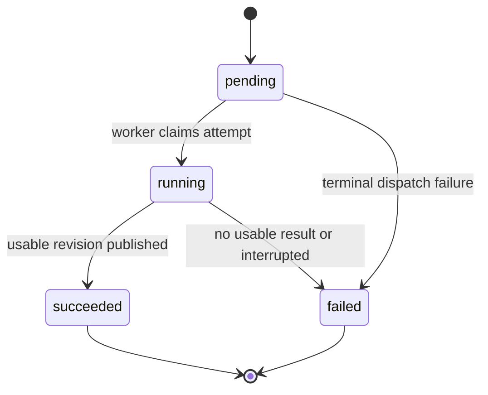

# Evidence and processing design

Design rationale, updated November 7, 2026. The owner accepted the complete first ingestion slice: PDF native text/English OCR, partial evidence, source representation, processing ownership, local storage, queue, initial bounds and test interfaces. The application now implements that boundary; [status](status.md) records verified behavior and its limits.

The [system design](ingestion-system.md) records the concrete accepted flow, schema, API shape, idempotency and recovery. Later retrieval, summaries and conversations remain separate slices.

## A running example

Consider a four-page operating report:

| Physical page | Content or observation |
| --- | --- |
| 1 | A passage reporting revenue of USD 125,000 |
| 2 | A table: Operations has 14 people in 2025 and 19 in 2026 |
| 3 | A scan saying the renewal date is September 30, 2027 |
| 4 | No content recovered; whether it is blank or unreadable is unknown |

Someone asks, "How many people were in Operations in 2026?" The evidence needs the department, year header, value 19, and page location together. Page 4's uncertainty does not prevent this answer from being grounded in page 2. A question whose evidence might be on page 4 cannot turn an extraction miss into proof that the original never mentions it.

## What to store

| Option | Benefit | Tradeoff |
| --- | --- | --- |
| Page text or Markdown only | Easy to inspect and store | Table relationships and precise source locations can be lost. |
| Raw Docling result as the application model | Keeps the parser's rich representation with little mapping | Retrieval, citations, and callers must understand the parser's schema and changing item references. |
| Small Folio evidence model, plus original and raw result | Keeps source references and table meaning stable while concentrating parser integration | A modest, explicit mapping step must be maintained and tested. |

Selected: the third option, with a concrete Docling module and a small evidence contract. Docling supplies content items, hierarchy, reading order and available provenance. The mapper follows each supplied tree's order; it does not invent interleaving between body content and page furniture or merely concatenate `texts` and `tables`. [Docling document model](https://docling-project.github.io/docling/concepts/docling_document/).

Store these concepts; they do not imply a class hierarchy or a database table for every row:

| Concept | Contents and purpose |
| --- | --- |
| Original document | Document ID, original PDF bytes/storage key, content hash, filename, media type, size and physical page count when known. The hash identifies bytes; duplicate-upload behavior is a separate policy. |
| Extraction revision | An immutable saved result linked to that document/hash: parser/package/model configuration, configuration fingerprint, normalization schema version, creation time and raw Docling artifact reference. |
| Source elements | Text, heading/list/caption roles, structured tables, reading order and heading context. IDs are unique within a revision. Keep table cells, row/column positions, spans and header roles. |
| Source locations | Physical page references per published element, supplied element boxes normalized to top-left PDF points, and page dimensions. Raw results retain provider geometry, including table-cell boxes. Do not fabricate missing precision. |
| Page observations and diagnostics | Pages with recovered content, pages with no recovered content, explicit failures and limitations. An empty page has an unknown cause unless another signal establishes it. Preserve document-wide errors without inventing page numbers. |
| Processing request and attempts | Durable work intent, status, attempt identity, times, retry eligibility, errors, resource observations when measured, and the attempt currently allowed to publish. |

For page 2, an element such as `revision R1 / table T1` contains the full table and its location. A future answer references that revision and element, with page 2 as its human-readable locator. It need not promise cell-level highlighting when only table-level provenance is reliable. The measured Docling table/cell boxes have different coordinate origins; source inspection must convert them deliberately.

The original PDF is the source of truth. Extracted text is an imperfect representation that supports retrieval and verification. Only mark a particular element as OCR-derived when the parser actually provides that information; a document-level OCR setting does not prove every element used OCR.

Retrieval chunks are later, derived search units. They point back to these source elements. Changing chunk size or embedding model should not silently rewrite old citation evidence. Chunking and embedding configuration belong to a later index revision, not the extraction identity.

Originals and raw parser results are retained in the shared local artifact volume; queryable metadata/elements are stored in PostgreSQL. Failed extraction also retains a diagnostic envelope when it can be written, even without a raw document. Table cells remain structured JSONB rather than separate relational rows. S3 is a later deployment option, not an implemented adapter.

## Processing state

| Option | Benefit | Tradeoff |
| --- | --- | --- |
| One document status such as ready/partial/failed | A simple field for callers | Cannot explain failed reprocessing with still-usable evidence, or successful extraction with a failed summary, without accumulating combinations. |
| Execution status plus evidence availability and diagnostics | Explains what happened and what remains usable independently | Callers interpret a few explicit fields; a display label can be derived from them. |

Selected: the second option. The initial application exposes extraction execution, evidence availability and diagnostics. Indexing, summaries and insights need their own stage results when implemented, each tied to its input extraction revision.

An extraction attempt follows:

The state names above describe execution, not completeness:

- `pending`: a pre-created attempt is waiting for dispatch/execution. The initial request and its first pending attempt are created together. Do not claim that the broker acknowledged delivery merely because a database row exists.
- `running`: a worker currently owns the attempt. An expiring ownership claim lets recovery identify abandoned work.
- `succeeded`: a usable extraction revision was durably published. It can still contain coverage warnings.
- `failed`: the attempt ended without publishing usable evidence. An earlier published revision, if any, stays available. If the parser returns normally with zero usable content, preserve its reported success alongside Folio's `no_usable_content` outcome. Retry eligibility follows the reason, not the word `failed`.

A retry creates a new attempt linked to the same request, preserving the failed record. Accepted defaults allow three attempts, with 15/60-second retry delays plus persisted jitter for eligible failures. Attempt rows store outcomes and timestamps; this is not a separate event log or event-sourcing framework.

Accepted minimum usable evidence: at least one nonempty text/table element with an attributable physical PDF page. Every published element must meet that rule. Unlocated material stays in the raw result with a diagnostic; it does not discard useful located elements. This is a checkability rule, not an accuracy score: no minimum confidence, character count or complete-document threshold.

For the example, the observable result is: execution succeeded; evidence available; pages 1-3 have recovered elements; page 4 has no recovered content and an unknown cause. This is neither a complete-extraction certificate nor a numerical accuracy score. A user-facing label can say "Available with warnings."

Once search and summaries exist, extraction availability alone does not imply chat readiness. For example, indexing can be ready while summary generation failed; chat can use the indexed evidence while the summary error remains visible. Stage outputs always name their input revision, so an old summary cannot masquerade as a summary of newly extracted content.

## Crash recovery and publication

The selected design uses durable pending work plus a small dispatcher/recovery loop for one ingestion job type. A generic event/outbox framework or workflow engine would add concepts not currently needed.

1. Store the original PDF durably and commit its document record, work request and first pending attempt before returning acceptance.
2. Try to dispatch that request through the selected queue. If dispatch or the request process fails, recovery can discover the pending request and try again. Database intent alone is insufficient without this recovery path.
3. Queue delivery identifies the existing request and attempt; it does not create an independent attempt. A request has one currently authorized attempt. Only an authorized retry creates another. Re-delivery after successful request completion is a no-op. A worker claims that attempt and parses outside the database transaction.
4. Stage the completed result/artifacts. In a short PostgreSQL transaction, publish the evidence revision, record the attempt outcome, and update the active reference only if the attempt is still entitled to finish. An expired worker cannot overwrite newer work.
5. Preserve failure codes, timings and attempt history. Retry transient failures within agreed bounds; an invalid or unsupported input needs a useful error, not endless retries.

A PostgreSQL transaction makes the database publication all-or-nothing; it does not make filesystem writes or queue publication atomic with that transaction. Artifact references must point to durable completed files before commit. A crash can leave an unreferenced staged file; define cleanup without making an unfinished artifact visible. [PostgreSQL transaction semantics](https://www.postgresql.org/docs/current/tutorial-transactions.html).

When a parser returns a useful partial result, it can be published after validation. A killed process may leave no durable partial result at all. This design does not promise page-by-page streaming or recovery of arbitrary in-memory progress.

The first slice need not expose a user-facing reprocess operation. Its data model should allow a later revision R2 without mutating R1. Retain old revisions while references depend on them. Before enabling reprocessing, decide replacement of a usable but less informative candidate and conversation/index revision binding. More characters alone do not establish improved quality; never silently merge pages from different attempts.

RQ supplies delivery/execution and parent supervision; PostgreSQL supplies application intent, ownership and bounded retries. The dispatcher uses RQ job state to distinguish healthy queued work from lost/terminal delivery. Those responsibilities are intentionally separate.

## Modular implementation direction

Prefer feature-focused modules with small interfaces and related behavior kept together. File length is a review signal, not a target. Split when responsibilities or reasons to change diverge; avoid one-line forwarding modules and speculative shared abstractions.

Current modules under [src/folio](../src/folio), in request-to-result order:

| Boundary | Modules |
| --- | --- |
| HTTP and acceptance | `api.py`, `acceptance.py`, `storage.py` |
| Durable schema and queries | `database.py`, `migrations/`, `queries.py` |
| Delivery and execution | `dispatcher.py`, `__main__.py`, `processing.py` |
| Ownership and final outcomes | `ownership.py`, `publication.py`, `recovery.py` |
| Parser integration and evidence | `parsing/parser.py`, `parsing/evidence.py` |

The [learning guide](system-design-walkthrough.md) links each file to the question it answers.

HTTP handlers and queue tasks stay thin. Docling types stay in the parser module. Transactional rules belong together in persistence, not repeated across handlers. Use ordinary functions/data structures first; introduce reusable interfaces where an actual variation or independently testable external integration warrants them. Add the settings, migrations and tests required by each behavior as it is built, without generating future chat/search packages.

## Reviewable slices and agent use

Keep one implementation increment active. Parallelize independent research and review; delegate an entire behavior across its necessary files to one implementer. The brief names the user outcome, accepted contract, owned paths, exclusions and verification command.

For every meaningful behavior: agree its observable result, observe one useful failing test, implement enough to pass, independently review and simplify, then demonstrate it. A small passing commit is a review checkpoint. The next increment should remain easy to explain in one request-to-result walkthrough.

Accepted increments inside the first upload-to-evidence slice:

1. Upload one text PDF, process it asynchronously, and retrieve persisted evidence/source references and attempt timing.
2. Preserve the same flow for the report's table, OCR page and unknown no-content page, including honest warnings.
3. Verify no-usable-content behavior and recovery after duplicate delivery, dispatch failure and worker interruption. These safeguards are part of finishing this slice, not a distant reliability phase.

Accepted test interfaces, with current checks reported in [status](status.md):

| Interface | What its checks catch | What they do not establish |
| --- | --- | --- |
| Upload/status/evidence HTTP flow with real database and worker | Persistence, accepted-to-available behavior, source scope and displayed diagnostics | General parser accuracy or every crash interleaving |
| Docling-to-Folio extraction result, using known small real PDFs | Table/header meaning, OCR facts, physical pages, supplied locations and warning mapping | Accuracy across arbitrary documents or provider guarantees |
| Processing/recovery use case, with real persistence/queue and controlled external failures | Retry, duplicate publication, dispatch-gap and obsolete-worker behavior | Distributed exactly-once execution or exhaustive fault tolerance |

Do not assert helper call order, SQL spelling, private methods or exact future model prose. Exercise failures deterministically where possible; use real integrations when persistence/delivery is the behavior being tested. No model calls are needed for this slice.

Each checkpoint should provide the runnable command/result, a concise diff, independent-review findings, and a walkthrough of the actual files: entry point, state change, parser/storage work, result and one failure path. Explain where a change would go and why the alternative was rejected. The owner should be able to find responsible code and predict its behavior; memorizing library internals is unnecessary. Keep `AGENTS.md` short, accepted rationale in the decision log, and verified progress in status.

This workflow adapts primary practitioner evidence:

- Simon Willison's [red/green TDD](https://simonwillison.net/guides/agentic-engineering-patterns/red-green-tdd/) and [linear walkthroughs](https://simonwillison.net/guides/agentic-engineering-patterns/linear-walkthroughs/) support observable failing tests and explanations grounded in real source files. These are practitioner methods, not proof of a universally optimal process.
- The Claude Code team's [October 15, 2026 review account](https://claude.dev/blog/solving-code-review-at-anthropic/) describes runnable evidence, fresh-context reviewers, small changes and short instruction documents. Its mature team's automation goals differ from a learning-focused workflow; use the verification habits while preserving human understanding.
- Anthropic's [coding-skill study](https://www.anthropic.com/research/AI-assistance-coding-skills) involved 52 developers learning an unfamiliar library. Explanation/concept-seeking patterns were associated with stronger understanding than heavy delegation. The short study does not prove those patterns caused better long-term learning; it motivates reserving time for comprehension here.

## Decisions still needed

Agree useful summary/insight output, grounded-answer behavior, chunking/retrieval, index and conversation revision binding, and live model budgets before those slices. Wider OCR quality, deletion, storage/admission backpressure and any hosted-service boundary need separate evidence and policy. The accepted ingestion slice does not silently settle these choices.
