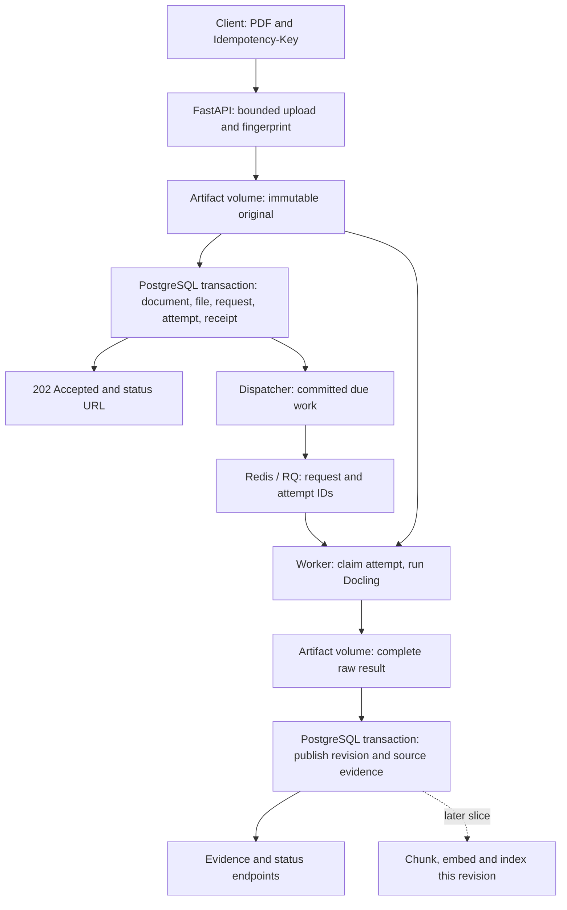
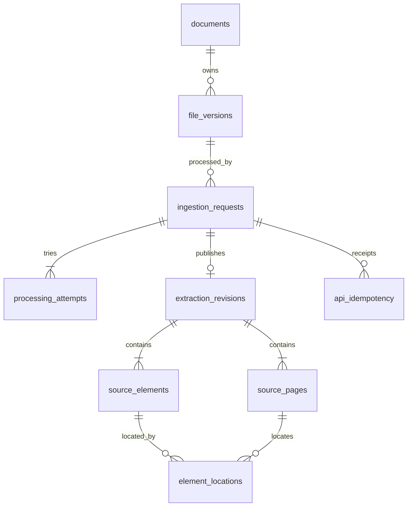

# First ingestion slice: system design

Accepted first-slice contract, November 7, 2026. This extends the [evidence design](ingestion-design.md) and now corresponds to the implemented ingestion application. Dependency choices, schema, idempotency/retry behavior, initial bounds and test interfaces were accepted together. See [status](status.md) for checks actually run and their limits; future retrieval/generation sections remain proposals.

## Scope and selected components

The completed slice accepts a PDF, runs extraction asynchronously, and exposes durable evidence, source references, warnings and processing history. It includes recovery and repeat-delivery behavior. It does not generate summaries, embeddings or answers yet.

| Responsibility | Selection | Why / alternative |
| --- | --- | --- |
| HTTP application | FastAPI | A small typed Python HTTP interface; keep processing outside request handlers. |
| Persistent application state | PostgreSQL | Stores accepted work, attempts, evidence and constraints. It remains the authority if the broker loses data. |
| Queue transport and execution | RQ + Redis | A small job interface and isolated per-job execution. Celery offers richer routing/pools; a PostgreSQL queue such as Procrastinate can remove Redis and atomically enqueue with application rows, but needs a native-parser isolation/recovery plan. |
| Parser | Docling, already selected | Preserve native text, English OCR, table structure and available provenance. |
| PDF and raw-result artifacts | Docker named volume, shared by local API/worker containers | Fits one local host. S3 becomes useful for hosted/multi-host workers. Store opaque keys in PostgreSQL, never user filenames as filesystem paths. |
| Later vector search | Recommend pgvector inside PostgreSQL when retrieval is implemented | Keeps evidence and vectors together initially. Qdrant remains an alternative if independent vector-service scaling/features justify its synchronization cost. No vector columns, embeddings or approximate index in this slice. |

Local [Compose](../compose.yaml) roles: `api`, `dispatcher`, `worker`, `postgres`, `redis`, plus a one-shot migration service. The dispatcher is a small application process using the same codebase. Only the API is exposed on localhost. PostgreSQL, Redis and artifacts have separate persistent volumes; the worker has build-time parser/model assets. Only the worker image needs the heavy parser runtime.

RQ executes one job per worker; begin with one Linux `SpawnWorker` and bounded native threads. It isolates Docling work, but model startup happens again per job, so the earlier warm-parser timings are not a production latency prediction. Use JSON task arguments, never document bytes or credentials in queue messages. RQ supplies execution machinery; PostgreSQL supplies Folio's durable work contract. [RQ workers](https://python-rq.org/docs/workers/).

Redis uses a persistent volume, AOF persistence and no key eviction. AOF reduces loss risk but does not make enqueue atomic with a PostgreSQL commit. Recoverable PostgreSQL intent is still required. [Redis persistence](https://redis.io/docs/latest/operate/oss_and_stack/management/persistence/).

Named volumes survive container replacement but remain host storage. They are not off-machine backup or high availability. An S3 object write is also separate from the database transaction; moving storage later does not remove that consistency problem. [Docker volumes](https://docs.docker.com/engine/storage/volumes/), [S3 consistency model](https://docs.aws.amazon.com/AmazonS3/latest/userguide/Welcome.html#ConsistencyModel).

## End-to-end request

Example: upload `operating-report.pdf`, containing revenue on page 1, a department/year table on page 2, a scanned renewal notice on page 3, and no recovered content on page 4. IDs below are readable aliases; actual IDs are UUIDs.



1. **Receive:** `POST /documents`, multipart PDF plus `Idempotency-Key`. Middleware bounds the actual request body; the multipart parser spools the upload. Acceptance then copies that spool in chunks to a uniquely owned artifact temporary file while checking PDF signature, actual file size and hash. This is bounded spooling followed by streaming/hash, not a direct socket-to-artifact stream. Full decoding, encryption/page-limit checks and OCR happen in the worker. Upload does not hold a database transaction.
2. **Finish the file:** finalize the complete original under an opaque immutable key such as `originals/<random-id>.pdf`. Same-filesystem temporary/final storage and appropriate file/directory flushing address local crash durability. Do not acknowledge merely because a pathname was renamed.
3. **Accept atomically in PostgreSQL:** create document D1, immutable file F1, request J1 and pending attempt A1; fill their ownership pointers and insert the idempotency receipt in the same short transaction. The receipt's unique constraint is the concurrency authority. Roll back the entire losing transaction on a receipt-key conflict before comparing the existing receipt in a fresh transaction. Do not commit a losing document with `ON CONFLICT DO NOTHING`.
4. **Respond:** after commit, return `202 Accepted`, D1/F1/J1 and a status URL. Acceptance means the original and work intent are saved, not that extraction succeeded. If the response is lost, replaying the key recovers those same IDs.
5. **Dispatch:** the dispatcher reserves committed due work with a fresh `dispatch_token`, then records a transport job ID before enqueueing J1/A1. The token identifies this dispatch reservation; the transport ID identifies the RQ delivery. Acknowledgment checks both, preventing an expired dispatcher from overwriting a newer reservation. Startup/periodic recovery discovers pending work even if the API dies after commit; an enqueue error leaves it recoverable.
6. **Claim:** the workhorse locks the relevant request/attempt, checks that J1 is open and A1 is still authorized and pending, sets a fresh claim token/deadline, and marks A1 running. Keep the entry module lightweight and claim before loading Docling/models so initialization failures are attributable to an attempt. A duplicate cannot acquire the same running attempt. Completed, stale or not-yet-due deliveries are no-ops; they never create attempts by themselves.
7. **Extract:** fetch F1, verify its identity/hash, and run Docling outside database transactions. Map text/table elements in reading order and preserve supplied locations. The output records no-content pages and actual diagnostics without claiming complete understanding.
8. **Stage and publish:** write the complete raw result under a unique opaque result key. Then lock document -> request -> attempt consistently and verify request ownership, claim token, status and unexpired deadline using database time. Insert R1 and its pages/elements/locations and complete J1/A1 in one short transaction. Promote R1 only if `documents.current_request_id` still names J1; an older distinct request may complete as historical evidence but cannot replace newer intended work. No reader observes half-published evidence. PostgreSQL does not include filesystem writes in this atomic transaction.
9. **Inspect:** request status reads state, attempts and revision in one repeatable-read snapshot. Evidence retrieval returns immutable R1, pages, diagnostics and a reading-order cursor. Page 4's unknown limitation does not disable the table on page 2. Raw artifacts are retained internally; there is no raw-result download endpoint.
10. **Later handoff:** the retrieval feature consumes a committed revision ID. It loads those source elements, builds chunks retaining element references, generates embeddings and creates a versioned index. Summary generation can consume the same committed evidence independently. The current slice stops at inspectable extraction; it does not claim that summaries or chat are ready.

The future indexing handoff must have durable pending work as well; a volatile event alone cannot be its only trigger. Implement that enqueue/publication step with the indexing feature, not a placeholder job now.

## Identity, file versions and extraction revisions

`D1` is the logical document. `F1` is one immutable set of PDF bytes. `R1` is one extraction of F1. A new parser/configuration can produce R2 from the same F1. A future replacement PDF becomes F2 under D1 and can produce R3. Those are different operations:

```text
D1
  F1: original uploaded bytes
    R1: first extraction
    R2: later extraction with changed processing
  F2: future replacement bytes
    R3: extraction of the replacement
```

This makes future updates possible, but this slice does not implement document replacement, a knowledge-base abstraction, revision-history UI, or automatic merging. Old citations retain their extraction revision and element identities. A failed replacement must not relabel F1/R1 as evidence from F2. Before enabling replacements, decide conflict checking, active-version selection, deletion/retention and conversation/index revision binding.

## Relational schema

Use UUID IDs, UTC `timestamptz` times and explicit foreign keys. Normalize relationships between documents, files, work and evidence. JSONB is a deliberate choice for immutable parser configuration, diagnostics and whole-table payloads, not a claim that all content is relationally normalized.

The [initial migration](../src/folio/migrations/001_ingestion.sql) defines these relationships; [migration 002](../src/folio/migrations/002_delivery_claims.sql) adds dispatch tokens and unique evidence ordering.

| Table | Columns / ownership |
| --- | --- |
| `documents` | `id PK`, `display_name`, `created_at`, nullable `current_request_id`, nullable `active_revision_id`. Latest requested work and active usable evidence are distinct. |
| `file_versions` | `id PK`, `document_id FK`, `original_filename`, `media_type`, `byte_size`, `sha256`, `storage_key UNIQUE`, `created_at`. Original bytes are immutable; hash is not globally unique. |
| `ingestion_requests` | `id PK`, `document_id`, `file_version_id`, `state` (`open/succeeded/failed`), `authorized_attempt_id`, immutable `requested_config JSONB`, `config_hash`, `created_at`, `finished_at`. One logical extraction request. |
| `processing_attempts` | `id PK`, `request_id FK`, `attempt_no`, `state` (`pending/running/succeeded/failed`), `available_at`, `claim_token`, `lease_expires_at`, `started_at`, `finished_at`, `error_code`, `error_detail`, `parser_status`, `retryable`, `metrics JSONB`, optional `diagnostic_storage_key/diagnostic_sha256`, `dispatch_token`, `transport_job_id`, `last_dispatched_at`, `next_dispatch_at`, `dispatch_claim_until`, `dispatch_count`, `terminal_delivery_failures`, `dispatch_error`. Failed results can retain a diagnostic envelope without publishing evidence. Queue deliveries do not consume processing attempts. |
| `extraction_revisions` | `id PK`, `document_id`, `file_version_id`, `request_id UNIQUE`, `publishing_attempt_id`, `created_at`, actual `parser_manifest JSONB`, `normalization_version`, `raw_storage_key UNIQUE`, `raw_sha256`, `diagnostics JSONB`. Only published usable results appear here. |
| `source_pages` | PK `(revision_id, page_no)`, `width_pt`, `height_pt`, `content_observation`, `diagnostics JSONB`. Physical page inventory, including no-content pages. |
| `source_elements` | PK `(revision_id, element_id)`, `kind`, `reading_order`, optional `parent_element_id`, `text`, `table_data JSONB`, optional `provider_ref`. Headers/cells belong together; parent references stay in the same revision. |
| `element_locations` | PK `(revision_id, element_id, location_no)`, `page_no`, optional text `char_start/char_end`, optional `x0/y0/x1/y1`. Source coordinates are deliberately normalized to top-left PDF points; original geometry remains in the raw result. Missing boxes stay null. |
| `api_idempotency` | PK `(scope, operation, key)`, `request_fingerprint`, `request_id FK`, `created_at`. One HTTP receipt; initial server-controlled scope is local single-user. It is not an authentication system. |

The request's state is the logical outcome. It stays open while an unsuccessful attempt is followed by an authorized retry. The status API can derive pending/running from the current attempt; a succeeded request still need not have complete coverage. Processing history preserves each previous attempt. Initially, cyclic pointers can be null while rows are inserted inside the transaction, but completing them before commit is an explicit acceptance invariant to test.



The ER sketch shows ownership, not every active/current pointer. Important database rules:

- `UNIQUE(request_id)` on revisions gives at most one published result per logical request, regardless of delivery duplication. A deliberate new reprocessing request can create a new revision.
- `UNIQUE(request_id, attempt_no)` and `UNIQUE(request_id, id)` on attempts make ordering unique and support an authorized-attempt FK scoped to its request.
- Composite FKs ensure that a request's `(document_id, file_version_id)` names that document's file; a revision's `(document_id, file_version_id, request_id)` names the matching request; and `(request_id, publishing_attempt_id)` names that request's attempt. Add the matching composite unique targets.
- Documents' pointers use `(id, active_revision_id) -> extraction_revisions(document_id, id)` and `(id, current_request_id) -> ingestion_requests(document_id, id)`, preventing a pointer to another document's work. The corresponding unique targets are `(document_id, id)`.
- Every source location references both `(revision_id, element_id)` and `(revision_id, page_no)`; parent-element references include the revision too. An R1 element cannot accidentally cite an R2 page.
- `UNIQUE(revision_id, reading_order)` makes the evidence cursor unambiguous; element identity remains `(revision_id, element_id)`.
- Check positive page/attempt numbers, nonnegative byte counts, coherent optional character spans and bounding boxes, and allowed states. Cross-table usable-evidence rules belong in publication validation rather than a misleading `CHECK` constraint. [PostgreSQL constraints](https://www.postgresql.org/docs/current/ddl-constraints.html).
- Published evidence is insert-only through the current application. Foreign keys alone do not make rows immutable; separate least-privilege database roles are not implemented.

Some ancestry IDs are deliberately repeated to support same-document/file composite constraints; their consistency is enforced, not maintained by convention alone. This is controlled redundancy for integrity. Display-level status is a projection, rather than another authoritative `documents.status` to keep synchronized.

Why JSONB cells? Folio currently retrieves/cites a table as evidence. A single table payload preserves cells, headers, spans and optional geometry without many reconstruction joins. If cell-level updates, SQL analytics or individually constrained cell citations become requirements, normalize into `table_cells(revision_id, element_id, row_index, column_index, ...)`. Element/page identity already has relational guarantees; JSON cell coordinates do not magically inherit them.

Current access paths include composite unique indexes for document/file/request ancestry, `requests_file`, partial `attempts_pending_dispatch` and `attempts_expired`, the unique `(revision_id, reading_order)` index, `locations_page` and `receipts_request`. Migration 003 removes the redundant older evidence-order index. Do not assume a separate request-state index exists. Primary/unique constraints create indexes; foreign keys do not automatically index their referencing columns. The [reading guide](system-design-walkthrough.md) explains how to inspect actual plans.

## Example evidence response

Illustrative excerpt matching `GET /revisions/{revision_id}/evidence`, not measured application output. Short IDs, coordinates and content are examples; the real response also includes creation time, parser manifest and normalization version. Request/attempt state comes from the separate status endpoint.

```json
{
  "document_id": "D1",
  "file_version_id": "F1",
  "revision_id": "R1",
  "request_id": "J1",
  "diagnostics": [{"code": "NO_CONTENT_RECOVERED", "page_no": 4, "cause": null}],
  "pages": [
    {"page_no": 2, "width_pt": 612, "height_pt": 792, "content_observation": "content_recovered", "diagnostics": []},
    {"page_no": 4, "width_pt": 612, "height_pt": 792, "content_observation": "no_content_recovered", "diagnostics": [{"code": "NO_CONTENT_RECOVERED", "page_no": 4, "cause": null}]}
  ],
  "elements": [{
    "element_id": "T1",
    "kind": "table",
    "reading_order": 6,
    "parent_element_id": null,
    "text": null,
    "table_data": {
      "row_count": 2,
      "column_count": 3,
      "cells": [
        {"row": 0, "column": 0, "text": "Department", "column_header": true},
        {"row": 0, "column": 1, "text": "2025", "column_header": true},
        {"row": 0, "column": 2, "text": "2026", "column_header": true},
        {"row": 1, "column": 0, "text": "Operations"},
        {"row": 1, "column": 1, "text": "14"},
        {"row": 1, "column": 2, "text": "19"}
      ]
    },
    "locations": [{"page_no": 2, "char_start": null, "char_end": null, "x0": 60, "y0": 130, "x1": 420, "y1": 260}]
  }],
  "next_after_order": null
}
```

The excerpt omits pages 1 and 3 and cell span/role flags for space; the API returns the physical page inventory and those cell fields. Elements are paginated with `after_order` and `limit`; `next_after_order` is null at the end. Table indices are zero-based; PDF pages are one-based. Element locations use top-left PDF points; optional cell geometry remains in the raw result. No cell-highlighting UI is implemented. Unverified character offsets must not become invented precision.

## Idempotency, ownership and retries

There are two independent protections:

| Boundary | Rule |
| --- | --- |
| HTTP upload | Same scoped key + same fingerprint returns the existing IDs; same key + different input returns `409`. A new key with identical bytes creates another logical document unless deduplication is explicitly added. |
| Background processing | Duplicate messages may execute a delivery handler, but only the currently authorized claim can process/publish. A completed request is a no-op; a unique request-to-revision constraint is the final publication guard. |

Fingerprint the PDF hash, actual byte length, original filename and canonical explicit client options. Exclude mutable deployment configuration from replay comparison; the first accepted request freezes its effective parser configuration separately. Keep receipts initially rather than introducing silent expiry. Request-token records and resource mutations belong in one transaction. [AWS idempotent-API guidance](https://aws.amazon.com/builders-library/making-retries-safe-with-idempotent-APIs/).

PostgreSQL is the single authority for retry eligibility, delay and creating new attempt IDs. Do not configure RQ `Retry`, return an RQ retry instruction, or let another callback independently create attempts. RQ failure registries remain useful operational records. Transport redispatch of the same pending attempt does not consume the parse-attempt budget. [RQ retries](https://python-rq.org/docs/exceptions/).

The dispatcher/recovery loop runs at startup and periodically. It processes bounded batches with database claims so multiple instances do not intentionally dispatch the same due row concurrently. Inspect RQ job and queue/registry presence through supported APIs after a dispatch grace period; keep genuinely queued backlog waiting. Missing/terminal transport records with pending PostgreSQL work are redispatched with recorded delivery identity. Do not re-enqueue every healthy pending job on every sweep. Claim/publication checks remain necessary because a stalled dispatcher can outlive its dispatch lease and duplicate a delivery.

After enqueue succeeds or fails, update acknowledgment/error bookkeeping only if both `dispatch_token` and `transport_job_id` match. Record a terminal delivery failure and reserve its replacement identity in one transaction, so a crash cannot count the same failure twice. On extraction failure, retain an envelope containing available raw output, diagnostics, parser manifest/status and error code even when the raw document is absent. Attach it to the failed attempt only under current ownership; obsolete unreferenced output remains a cleanup candidate.

A job that fails before claiming PostgreSQL work, such as an entry-module import error, may remain in RQ's failed registry while the application attempt is still pending. Record each distinct terminal delivery failure once and cap repeated bootstrap failures at three with an explicit terminal deployment error. Broker unavailability records a dispatch error and schedules another dispatch check without consuming the parse budget. Healthy queued delay is not a transport failure.

A fixed lease begins only when a worker claims the attempt, not while it waits in Redis. Expiry revokes authority; it does not prove the old process is dead. Recovery marks that attempt failed and, if eligible, authorizes a new one. Every publication and failure-state update must check ownership: a late original process may neither publish nor mark a newer attempt's request failed. A still-valid claim prevents concurrent duplicate processing. Never reset a terminal attempt to pending. Queue delivery can be repeated; parsing can repeat after failures; the target guarantee is one published revision per request, not globally exactly-once execution.

Known transient I/O/worker-loss failures receive bounded retry. Encrypted/unsupported PDFs, page-limit violations, no usable source evidence and normalization defects receive useful terminal errors. Explicit resource exhaustion needs investigation rather than repeating an unchanged overload; an unexplained whole-worker loss may be retried within the same bounded budget. Unknown error classification is recorded conservatively.

## Failure walkthrough

| Failure point | What survives / recovery |
| --- | --- |
| Connection closes during upload | No accepted work exists. Remove only that upload's temporary data; client retries with its original key. |
| Blob completes, database definitely rolls back | No accepted document. The uniquely owned unreferenced blob can be removed. |
| Commit acknowledgment is lost | Commit may have succeeded. Preserve the blob; resolve through the receipt after reconnecting. Never delete on an ambiguous commit exception. |
| Database commit succeeds, API dies before enqueue or response | D1/F1/J1/A1 and receipt survive. Client replay gets original IDs; dispatcher finds pending work. |
| Redis unavailable or queued data lost | PostgreSQL intent survives. Record delivery trouble, wait/back off and redispatch once transport is usable. Healthy backlog is not a lost task. |
| Duplicate worker delivery | Conditional claim allows only one running owner. Another delivery returns without new evidence. |
| Worker/container dies during parsing | No new committed revision. RQ records what it can; PostgreSQL lease recovery marks failure and schedules an eligible bounded retry. |
| Native parser hangs | RQ parent supervision provides a harder stop when native code delays Python's signal handling. The opt-in stuck-job probe verified this with shortened settings; it did not measure the default 300-second timeout. |
| Raw result saved, publication transaction fails | No partial evidence is visible. Candidate artifact may remain unreferenced; retry uses another owned result key. |
| Publication commits, worker dies before RQ records completion | Request/revision already succeeded in PostgreSQL. Recovery/delivery becomes a no-op and must not reparse. |
| Some pages fail but usable evidence remains | Publish usable revision with actual diagnostics and coverage observations. Preserve the parser's own outcome separately. |
| Repeated retryable failure exhausts budget | Request becomes terminal failed; retain attempts and a readable reason for operator inspection. No infinite retry loop. |
| Host disk/database volume is destroyed | This local design cannot promise recovery without backups. Container persistence is not disaster recovery or HA. |

Artifact cleanup must not race uploads/publication. Each writer owns unique keys; a losing upload deletes only its own candidate after definite rollback. For the first local slice, reconcile abandoned artifacts during maintenance with all artifact writers stopped and PostgreSQL recovered. Online garbage collection requires explicit coordination; file age or absence from a current query alone is not sufficient proof of abandonment.

## Accepted initial operating bounds

Accepted November 7 and implemented in [validated configuration](../src/folio/config.py) and Compose. These are starting policies, not benchmark-derived capacity claims.

| Control | Accepted starting value |
| --- | --- |
| Maximum uploaded PDF | 25 MiB, enforced on actual streamed bytes |
| Maximum physical pages | 100; reject the document with a useful outcome rather than silently truncate |
| Parser document timeout | 240 seconds, cooperative |
| RQ job timeout | 300 seconds, including workhorse processing/publication |
| Worker monitoring interval | 10 seconds |
| Application ownership lease | 420 seconds from claim, exceeding the normal RQ supervision bound plus publication margin |
| Total parse attempts | 3 for eligible transient failures; first try plus two retries |
| Retry delays | 15 then 60 seconds plus uniform 0-5 second jitter, sampled once and persisted as the pending attempt's `available_at` |
| Recovery scan | 15 seconds, batch of 20; dispatch reservation/grace is 30 seconds |
| Local parser workers | 1 initially; measure before increasing |
| Worker envelope | 4 CPU quota, 6 GiB RAM, no extra swap, as a starting ceiling |

RQ 3.0's parent monitor can kill stuck work after `job.timeout + 60 seconds`, checked at its monitoring interval. Native code can delay signal handling, so 300 seconds is not an exact kill-at-300 guarantee. Configuration checks the conservative lease relationship. The opt-in probe observed parent termination and removal of the horse and same-group child with 1-second job/monitor settings; see [status](status.md) for the measured result. A fixed lease avoids a separate application heartbeat. [Versioned RQ worker implementation](https://raw.githubusercontent.com/rq/rq/v3.0/rq/worker/worker_classes.py).

Also bound request read time, artifact/database/Redis operations, upload concurrency, pending-work admission and storage usage before exposing the service beyond localhost. Exact numerical values for those workload controls follow implementation checks. A complete rejection/acceptance policy must remain visible; it must not silently drop queued work.

## Reviewable implementation and completion

The [source reading order](system-design-walkthrough.md) follows HTTP acceptance, dispatch, ownership, processing and publication. Only the parser boundary knows Docling types; transaction rules are shared through ownership/publication/recovery modules. No provider registry or general workflow engine is introduced.

Use three reviewable increments: (1) one text PDF across HTTP/storage/queue/worker/evidence, (2) table/OCR/coverage handling through the same path, (3) idempotency, retry and interruption checks. Each meaningful behavior gets its own observed failing test, minimal implementation, review and passing checkpoint; do not write an entire speculative suite first.

Accepted observable test interfaces are the upload/status/evidence HTTP flow, parser-to-evidence contract, and processing/recovery with real persistence/queue plus controlled faults. Software checks use deterministic fixtures and controlled failure points; no model call or embedding budget is needed. Completed results and operational probe limits are recorded in [status](status.md).

The smoke demonstration uploads safe fixtures, checks original bytes and page/table evidence, replays a request and inspects partial warnings. A separate recovery exercise covers broker outage, overlapping workers and a killed worker. Request status stores attempt timestamps and measured `parser_duration_seconds`: the full parser call includes admission, imports/model setup, conversion and mapping, excluding queue wait and publication. It is not the comparison's warm-conversion timing. Failed/killed calls may have no measured parser duration; recovery detection time is not a substitute.

The first usable routes are upload, document metadata/status, original-file retrieval, immutable revision/evidence retrieval and request/attempt inspection. Evidence listing is paginated. Global statistics and richer metrics endpoints can build on these stored facts in their planned slices; no static success dashboard or fabricated percentages.

Vector retrieval and generation remain separate decisions; this slice creates their stable evidence input. Global statistics, summaries, conversations and the final document-chat demonstration remain future work.
