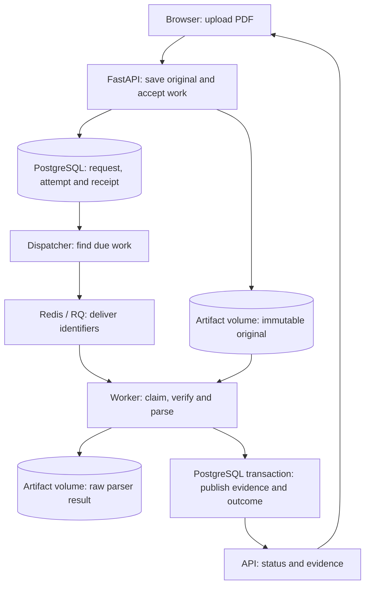

# Follow one document through Folio

Use your own PDF for this walkthrough. Folio's screens read the running API; there
are no built-in sample documents, success scripts or scenario switches. A small
readable document makes the first pass easier to inspect.

## Start with the browser

Start the local stack using the [setup instructions](../README.md). Open
[Folio](http://localhost:3000), choose a PDF, and select **Open document**.
The displayed file/page limits come from the API's current configuration.

Before uploading, open the browser's developer tools and select **Network**.
Filter for `/api/` to see the application requests:

| Request | What to inspect |
| --- | --- |
| `GET /api/capabilities` | Supported limits and whether development inspection is enabled. |
| `POST /api/documents` | Multipart file, `Idempotency-Key`, and the `202` response containing document/request identifiers. |
| `GET /api/documents/{id}` | The saved document and its current request identifier. |
| `GET /api/ingestion-requests/{id}` | Request outcome, attempts and the published revision identifier. Open requests are polled about every two seconds. |
| `GET /api/revisions/{id}/evidence` | Recovered text/tables, source locations, page observations and a pagination cursor. |
| `GET /api/documents/{id}/original?inline=true` | The preserved original used by the PDF preview. The download link omits `inline=true`. |

`202` means Folio accepted the work durably. Parsing can still be waiting, running
or unsuccessful. The document URL can be bookmarked and reopened; the browser
reconstructs its view from saved state. Closing the tab does not cancel accepted
work. Retrying an uncertain upload while keeping the same file selected reuses
its idempotency key; choosing a file again starts a new upload intent.

Inspect a recovered passage and use its page button to open the corresponding
original page. Compare the actual wording. For a table, compare the headers as
well as the values. Known coverage gaps stay visible even when useful evidence
is available. A page with no recovered text is not automatically a damaged page;
it could be blank. Native PDF preview support varies, so an open/download
fallback remains available. Embedded preview loads after usable extraction; open
and download links remain available during processing and after failure. This
avoids automatically activating an encrypted PDF's native password viewer.

## Where the work happens

The web container serves React assets and forwards `/api/` requests to FastAPI.
It removes that prefix: the backend route is still `/documents`, for example.
The frontend never connects directly to PostgreSQL or Redis.



A **request** represents one logical extraction. An **attempt** represents one
authorized try at completing it. A transient interruption can fail attempt 1
while the request stays open for attempt 2. The interface follows the authorized
attempt, so an earlier failure does not make a scheduled retry look terminal.

The original file and database transaction have separate durability boundaries.
After acceptance, PostgreSQL holds the work even if the browser or queue is
unavailable. A worker claims permission before parsing, and that permission has
an expiry time. Publication checks ownership again and commits the revision,
pages, elements and final state together. Repeated delivery cannot publish a
second revision for the same request.

## Inspect the real processing history

Set `FOLIO_DEVELOPMENT_MODE=true` in the existing ignored `.env`, preserving its
other values, then apply the configuration with `docker compose up -d`. This
setting defaults to false. It enables a server-gated inspection endpoint and the
**Development details** disclosure on the document page. It is a local debugging
setting, not an authentication mechanism.

Open that disclosure during an upload. It shows the request and attempt IDs,
original size/hash, frozen parser settings, delivery information, ownership
deadline and observed events. The event list polls while the request is open and
retains its recorded history after completion.

Read the events as observations:

- **Upload accepted:** the original and accepted database work exist. It does not
  retrospectively measure the browser's upload transfer.
- **Queue delivery requested:** a delivery was reserved. The later worker claim
  establishes that a worker took ownership; reservation alone does not prove it.
- **Original verified / parsing started / parsing completed / raw result saved:**
  actual execution milestones. Completed operations can include measured elapsed
  seconds; these measurements use a monotonic clock.
- **Evidence published:** the publication transaction committed. PostgreSQL owns
  this outcome; an RQ function returning normally can also have recorded a failure.
- **Attempt failed / retry scheduled:** inspect the error code and the authorized
  next attempt. An ownership deadline is not an exact crash timestamp.

Event timestamps come from PostgreSQL and are displayed in local time. A stage
without a completion has no recorded finish. History can have gaps, and documents
processed before instrumentation can have no events. Recoverable SQL errors when
saving events are isolated with savepoints; losing the database connection can
still abort the surrounding transaction. Observations never override the saved
request outcome or grant a worker permission to publish.

For process output, run:

```sh
docker compose logs --follow --tail 50 api dispatcher worker
```

Match the request/attempt IDs to the development view. Application lifecycle logs
include those identifiers without copying document text. `Ctrl+C` stops following
logs; it does not stop the containers. `docker compose ps` shows service state;
the API health check alone does not prove a worker is available.

## Try a real waiting job

With no other document processing in progress, stop the worker:

```sh
docker compose stop worker
```

Upload a PDF normally. It should receive a document URL and remain **Waiting to
process**. Inspect its accepted request and pending attempt. Copy the URL and
close the tab if you want to verify that the browser is not keeping the work alive.

Restart the worker:

```sh
docker compose up -d worker
```

Reopen the saved URL. Observe the worker claim, processing and actual result.
This exercises waiting and resumption with real services. It does not measure
crash recovery; the separate [recovery exercises](development.md#fault-exercises)
cover that behavior and their timing limitations.

## Read the code in this order

| Start here | Follow this responsibility |
| --- | --- |
| [`UploadPage.tsx`](../web/src/documents/UploadPage.tsx), [`api.ts`](../web/src/api.ts) | Selected file, upload intent, HTTP request and navigation to its saved URL. |
| [`api.py`](../src/folio/api.py), [`acceptance.py`](../src/folio/acceptance.py) | Input checks, original storage, transaction and idempotency receipt. |
| [`dispatcher.py`](../src/folio/dispatcher.py), [`ownership.py`](../src/folio/ownership.py) | Due work, queue delivery and conditional worker ownership. |
| [`processing.py`](../src/folio/processing.py), [`publication.py`](../src/folio/publication.py), [`recovery.py`](../src/folio/recovery.py) | Parser execution, publication and bounded failure/retry behavior. |
| [`useDocument.ts`](../web/src/documents/useDocument.ts), [`EvidenceReader.tsx`](../web/src/documents/EvidenceReader.tsx) | Status polling, evidence pagination and source inspection. |
| [`development.py`](../src/folio/development.py), [`DeveloperPanel.tsx`](../web/src/development/DeveloperPanel.tsx) | Safe database inspection and its development-only display. |

Automated checks use controlled files so their expected content is independently
known. Those files are test inputs, not runtime content or a special processing
path. The browser checks upload through the same API and worker used here.

Owner exercise: while the worker is stopped, explain which facts survive closing
the tab, which service must return before parsing can start, and why another
upload with a new idempotency key would create a new document.
