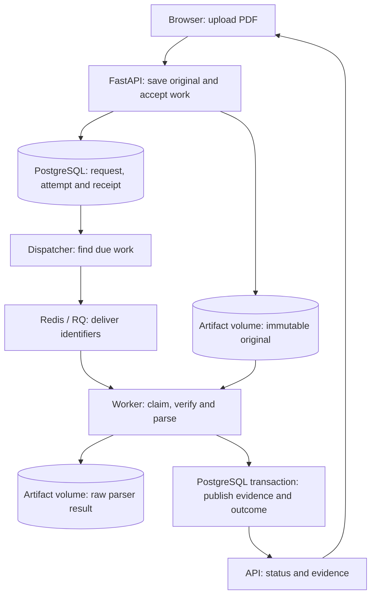

# Follow one document through Folio

Use your own PDF for this walkthrough. Folio's screens read the running API; there
are no built-in sample documents, success scripts or scenario switches. A small
readable document makes the first pass easier to inspect.

## Start with the browser

Start the local stack using the [setup instructions](../README.md). Open
[Folio](http://localhost:3000), choose a PDF, and select **Open document**.
The displayed file/page limits come from the API's current configuration.

Before uploading, open the browser's developer tools and select **Network**.
Filter for `/api/` to see the application requests:

| Request | What to inspect |
| --- | --- |
| `GET /api/capabilities` | Supported limits and whether development inspection is enabled. |
| `POST /api/documents` | Multipart file, `Idempotency-Key`, and the `202` response containing document/request identifiers. |
| `GET /api/documents/{id}` | The saved document and its current request identifier. |
| `GET /api/ingestion-requests/{id}` | Request outcome, attempts and the published revision identifier. Open requests are polled about every two seconds. |
| `GET /api/revisions/{id}/evidence` | Recovered text/tables, source locations, page observations and a pagination cursor. |
| `GET /api/documents/{id}/original?inline=true` | The preserved original used by the PDF preview. The download link omits `inline=true`. |

Remove the `/api/` filter to inspect the PDF viewer's local worker and font/image
decoder assets. The worker's `.mjs` response must be JavaScript. Missing
`/pdf-assets/` files must return `404`, not the application's HTML shell with
`200`; otherwise an asset problem becomes a confusing decoder error.

`202` means Folio accepted the work durably. Parsing can still be waiting, running
or unsuccessful. The document URL can be bookmarked and reopened; the browser
reconstructs its view from saved state. Closing the tab does not cancel accepted
work. Retrying an uncertain upload while keeping the same file selected reuses
its idempotency key; choosing a file again starts a new upload intent.

Inspect a recovered passage and use its page button to open the corresponding
original page. Compare the actual wording. For a table, compare the headers as
well as the values. Known coverage gaps stay visible even when useful evidence
is available. A page with no recovered text is not automatically a damaged page;
it could be blank. The coverage notice shows a recovered-page count and known
timeout reason where reported. Expand its bounded details to inspect missing
page ranges and other diagnostics.

Original renders one page locally with selectable text and Folio's page controls.
On mobile, a source citation selects the Original tab; returning to Content keeps
the loaded evidence and reading position. Preview loads after usable extraction;
open/download fallbacks remain available during processing and after failure.
The viewer does not render every page or rerun document extraction.

There are two different workers here. Docling's backend worker extracts evidence
and saves it in PostgreSQL. PDF.js uses a browser worker to read the original PDF
and draw the page you selected. Clicking page 2 changes that browser view; it
does not create another ingestion job or model call. The page image has a text
layer so its words remain selectable.

## Where the work happens

Conversation history lives beside the workspace on wide screens. On narrower
screens, **Open conversation history** opens the same list in a drawer. Select a
conversation to reopen its saved question and result; Runs remains separate
document-processing history in the header. The home screen opens a document.

History uses `GET /api/conversations?limit=20` and the returned cursor for older
pages. These are reads of existing records, not new model requests or a second
history store. A history-loading failure has its own retry action and does not
erase the selected conversation or already loaded history. New questions still use the existing submission
and idempotency flow. One question per conversation remains the current limit;
the interface does not offer an unsupported follow-up composer.

An unsent question stays in this browser tab's session storage when switching
chats. It is separate from the submission key used to recover an uncertain send;
neither is a second server transcript. History fetches at most 20 conversations
per page. Latest/Older changes the page; ordinary refresh keeps your place.

For the UI reading order, start with `web/src/App.tsx` for the shared shell,
`conversations/ConversationSidebar.tsx` and `useConversationList.ts` for history,
then `ConversationPage.tsx` and `QuestionComposer.tsx` for the selected chat.
Layout rules live in `styles/navigation.css` and `styles/conversations.css`.
The existing source panel opens original PDF pages; it does not ask a model again.
The main pane owns page scrolling, while history scrolls independently. On mobile,
the document reader saves that main-pane position before opening Original and
restores it on return to Content. Try that round trip halfway down a PDF to check
the behavior yourself without triggering any model work.

The web container serves React assets and forwards `/api/` requests to FastAPI.
It removes that prefix: the backend route is still `/documents`, for example.
The frontend never connects directly to PostgreSQL or Redis.



A **request** represents one logical extraction. An **attempt** represents one
authorized try at completing it. A transient interruption can fail attempt 1
while the request stays open for attempt 2. The interface follows the authorized
attempt, so an earlier failure does not make a scheduled retry look terminal.

The original file and database transaction have separate durability boundaries.
After acceptance, PostgreSQL holds the work even if the browser or queue is
unavailable. A worker claims permission before parsing, and that permission has
an expiry time. Publication checks ownership again and commits the revision,
pages, elements and final state together. Repeated delivery cannot publish a
second revision for the same request.

## Inspect the real processing history

Set `FOLIO_DEVELOPMENT_MODE=true` in the existing ignored `.env`, preserving its
other values, then apply the configuration with `docker compose up -d`. This
setting defaults to false. It enables a server-gated inspection endpoint and the
**Activity** side panel on the document page. It is a local debugging
setting, not an authentication mechanism.

Open Activity during an upload. It shows the request and attempt IDs,
original size/hash, frozen parser settings, delivery information, ownership
deadline and observed events. The event list polls while the request is open and
retains its recorded history after completion. The panel scrolls independently;
Escape closes it and returns keyboard focus to Activity. Closing the panel stops
inspection polling without changing the processing job.

Read the events as observations:

- **Upload accepted:** the original and accepted database work exist. It does not
  retrospectively measure the browser's upload transfer.
- **Queue delivery requested:** a delivery was reserved. The later worker claim
  establishes that a worker took ownership; reservation alone does not prove it.
- **Original verified / parsing started / parsing completed / raw result saved:**
  actual execution milestones. Completed operations can include measured elapsed
  seconds; these measurements use a monotonic clock.
- **Evidence published:** the publication transaction committed. PostgreSQL owns
  this outcome; an RQ function returning normally can also have recorded a failure.
- **Attempt failed / retry scheduled:** inspect the error code and the authorized
  next attempt. An ownership deadline is not an exact crash timestamp.

Event timestamps come from PostgreSQL and are displayed in local time. A stage
without a completion has no recorded finish. History can have gaps, and documents
processed before instrumentation can have no events. Recoverable SQL errors when
saving events are isolated with savepoints; losing the database connection can
still abort the surrounding transaction. Observations never override the saved
request outcome or grant a worker permission to publish.

For process output, run:

```sh
docker compose logs --follow --tail 50 api dispatcher worker
```

Match the request/attempt IDs to the development view. Folio's application records
are single-line JSON with a UTC `timestamp`, `severity`, `component`, `pid`, `event`
and relevant identifiers. An API receipt and a worker result share a request ID;
a retry keeps that request ID and receives a new attempt ID. `component` identifies
the API, dispatcher or worker process. RQ, Uvicorn and parser dependencies retain
their own logging formats.

On PowerShell, isolate the known request without dumping unrelated records:

```powershell
$requestId = 'paste the request ID from Activity'
docker compose logs --no-color --no-log-prefix --tail 500 api dispatcher worker |
    Select-String -SimpleMatch $requestId
```

Use `--follow` to keep watching a request. `Ctrl+C` stops following logs; it does
not stop the containers. The tail limit only searches recent output; use the
saved development history to inspect older work. `docker compose ps` shows service
state; the API health check alone does not prove a worker is available.

For an unexpected execution error, the diagnostic record identifies the exception
class, operation and bounded application code locations. It deliberately excludes
the exception message, local variable values, document contents and artifact paths.
The diagnostic describes an observed exception; it does not prove that the worker
still owns the request or that its failure transaction committed. Consult saved
status and attempt history for that outcome.

For example, if parsing completes but publication is absent, the document is not
yet ready merely because a log says `parse_completed`. The raw-result write or
publication can still fail. The saved `published` event and succeeded request
identify the committed outcome. Logs are useful diagnostics, not a second work
queue or a complete copy of the timeline.

## Try a real waiting job

With no other document processing in progress, stop the worker:

```sh
docker compose stop worker
```

Upload a PDF normally. It should receive a document URL and remain **Waiting to
process**. Inspect its accepted request and pending attempt. Copy the URL and
close the tab if you want to verify that the browser is not keeping the work alive.

Restart the worker:

```sh
docker compose up -d worker
```

Reopen the saved URL. Observe the worker claim, processing and actual result.
This exercises waiting and resumption with real services. It does not measure
crash recovery; the separate [recovery exercises](development.md#fault-exercises)
cover that behavior and their timing limitations.

## Read the code in this order

| Start here | Follow this responsibility |
| --- | --- |
| [`UploadPage.tsx`](../web/src/documents/UploadPage.tsx), [`api.ts`](../web/src/api.ts) | Selected file, upload intent, HTTP request and navigation to its saved URL. |
| [`routes.py`](../src/folio/ingestion/routes.py), [`acceptance.py`](../src/folio/ingestion/acceptance.py) | Input checks, original storage, transaction and idempotency receipt. |
| [`dispatcher.py`](../src/folio/ingestion/dispatcher.py), [`ownership.py`](../src/folio/ingestion/ownership.py) | Due work, queue delivery and conditional worker ownership. |
| [`processing.py`](../src/folio/ingestion/processing.py), [`publication.py`](../src/folio/ingestion/publication.py), [`recovery.py`](../src/folio/ingestion/recovery.py) | Parser execution, publication and bounded failure/retry behavior. |
| [`useDocument.ts`](../web/src/documents/useDocument.ts), [`EvidenceReader.tsx`](../web/src/documents/EvidenceReader.tsx) | Status polling, evidence pagination and source inspection. |
| [`DocumentReader.tsx`](../web/src/documents/DocumentReader.tsx), [`PdfRenderer.tsx`](../web/src/documents/PdfRenderer.tsx) | Selected source page, responsive reading state, local PDF loading and bounded single-page rendering. |
| [`CoverageNotice.tsx`](../web/src/documents/CoverageNotice.tsx), [`coverage.ts`](../web/src/documents/coverage.ts) | Compact coverage explanation, grouped ranges and bounded detail pages. |
| [`development.py`](../src/folio/ingestion/development.py), [`DeveloperPanel.tsx`](../web/src/development/DeveloperPanel.tsx) | Safe database inspection and its development-only display. |

Automated checks use controlled files so their expected content is independently
known. Those files are test inputs, not runtime content or a special processing
path. The browser checks upload through the same API and worker used here.

Owner exercise: trace one request across its API receipt and worker logs. Explain
why `parse_completed` alone does not make it ready, and which saved event proves
publication. In the stopped-worker exercise, explain which facts survive closing
the tab and why a new idempotency key would create a new document.

For the reading view, select a citation and watch Network. Explain why changing
the displayed PDF page does not create another processing request. On a narrow
screen, return to Content and check that your reading position survived. A
preview failure should leave the extracted evidence and original download
available; it does not change the saved extraction outcome.
